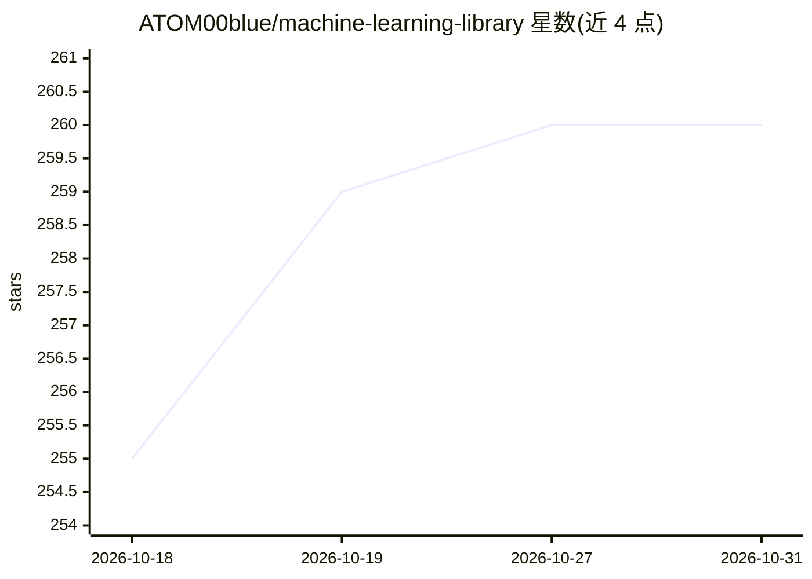

# ATOM00blue/machine-learning-library

⭐ 260 · Python · NOASSERTION · 推送 2026-08-10 · [GitHub](https://github.com/ATOM00blue/machine-learning-library) · 个人维护

**923 篇 ML 论文/讲义策展知识库 + 自研 APRL 表格学习算法**

两层结构：一是手工策展的机器学习知识库，收录 391 篇 arXiv 论文（78 篇全文）、474 份来自 MIT/Stanford/fast.ai 等课程的讲义转录和 58 篇经典讲解文，统一为带 YAML frontmatter 的 Markdown（约 1100 万 token），按 17 个主题标签组织，可作为 Obsidian vault 打开或供 AI agent 检索引用；二是 APRL，一个 NumPy 实现的自定义数值表格分类/回归算法，含测试、基准与不确定性估计，README 明确声明为实验性组合、不主张科学新颖性。全部来源保留出处并列入 SOURCES.md。

## 筛选速览

| 维度 | 判定 | 备注 |
|---|---|---|
| AI 角色 | `ai-knowledge` | 知识聚合/清单类 |
| 许可风险 | `none` | NOASSERTION |
| 部署形态 | `library` | 以包/库形式分发 |
| 模型依赖 | — | README 未给出锁定关系 |
| 硬件要求 | — | 无带数字的原话,不猜 |
| 安装摩擦 | `low` | 无编译、无系统依赖或容器化 |
| 成熟度 | `idea` | |

## 能力要点

- 923 份文档（391 论文 + 474 讲义 + 58 文章），约 1100 万 token，带受控标签体系
- APRL：全局 ridge + 原型加权 + 局部残差专家的 NumPy 分类/回归算法，含 11 个测试与五数据集基准
- 内置 .obsidian 配置与 AGENTS.md/CLAUDE.md，可直接接入 Cursor/Claude Code 等 agent
- 附 RAG 快速脚本（examples/rag_quickstart.py）

## 适用场景

- 搭建引用真实论文与讲义的 ML 问答/RAG 助手
- 作为小模型（1-7B）领域继续预训练或微调的数据集
- 评估嵌入模型与检索管线的技术语料
- 在 Obsidian 中按主题浏览组织机器学习学习路径

## 场景标签

`RAG` `教程课程` `精选清单` · 领域:知识与检索

## 证据(README 行号)

> L5: hand-curated, machine-readable knowledge base of leading university courses,
> L9: Custom classifier + regressor · 923 documents · ~11 million tokens · beginner to
> L54: |**Total documents**|923|

## 星数曲线

2026-10-18 255 → 2026-10-31 260（+5）

---
*卡片 v1 · prompt 1.4 · 生成 2026-10-22 · 置信度 high · 依据 README sha `25fa66c0b39e` · [字段定义](../../DATASET.md)*
