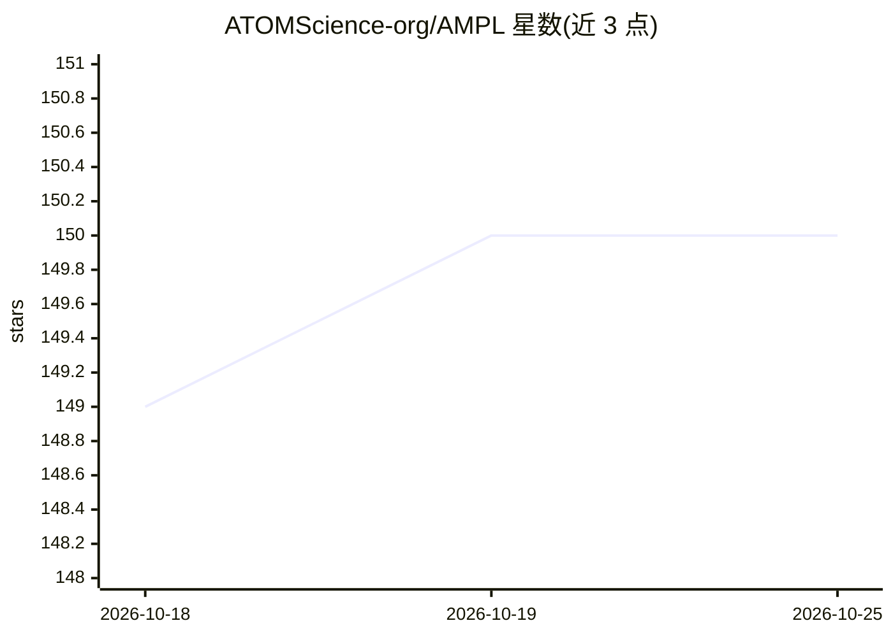

# ATOMScience-org/AMPL

⭐ 150 · Jupyter Notebook · MIT · 推送 2026-10-15 · [GitHub](https://github.com/ATOMScience-org/AMPL) · 组织维护

**面向药物发现的端到端分子性质建模流水线**

由 ATOM 联盟维护的开源流水线，覆盖数据整理、分子特征化（ECFP 指纹、图卷积潜向量、Mordred/MOE 描述符）、模型训练调优（随机森林、XGBoost、全连接与图卷积网络）与可视化分析，用于预测药物的效价、安全性与药代动力学相关参数。扩展 DeepChem 功能，在大量制药数据集上做过基准测试。支持 Python 3.10，提供 cpu/cuda/rocm/mchip 四种平台环境、PyPI 安装与 Docker 镜像，可从命令行、Python 脚本或 Jupyter 运行；MOE 描述符需 MOE 许可证。

## 筛选速览

| 维度 | 判定 | 备注 |
|---|---|---|
| AI 角色 | `ai-native` | 本体是模型或模型工具 |
| 许可风险 | `permissive` | MIT |
| 部署形态 | `self-host` | docker 或自建部署 |
| 模型依赖 | — | README 未给出锁定关系 |
| 硬件要求 | `cpu-ok` | |
| 安装摩擦 | `low` | 无编译、无系统依赖或容器化 |
| 成熟度 | — | 结构信号不足 |

## 能力要点

- 端到端覆盖数据整理、特征化、训练调优与预测
- 支持 scikit-learn 随机森林、XGBoost、全连接与图卷积模型
- 提供 ECFP 指纹、DeepChem 图卷积潜向量与 Mordred/MOE 描述符等特征化方式
- 提供 cpu/cuda/rocm/mchip 四种平台环境与 Docker 镜像

## 适用场景

- 在制药数据集上训练分子效价、安全性与药代性质预测模型
- 通过 JSON 参数文件运行建模与预测流水线
- 在 Jupyter 中以模块导入方式做分子性质预测

## 场景标签

`模型训练` · 领域:训练与推理

## 证据(README 行号)

> L9: An open-source, end-to-end software pipeline for data curation, model building, and molecular property prediction to
> L15: The ATOM Modeling PipeLine (AMPL) extends the functionality of DeepChem and supports an array of machine learning a

## 星数曲线

2026-10-18 149 → 2026-10-25 150（+1）

---
*卡片 v1 · prompt 1.4 · 生成 2026-10-22 · 置信度 high · 依据 README sha `f1f9a45ea6c2` · [字段定义](../../DATASET.md)*
