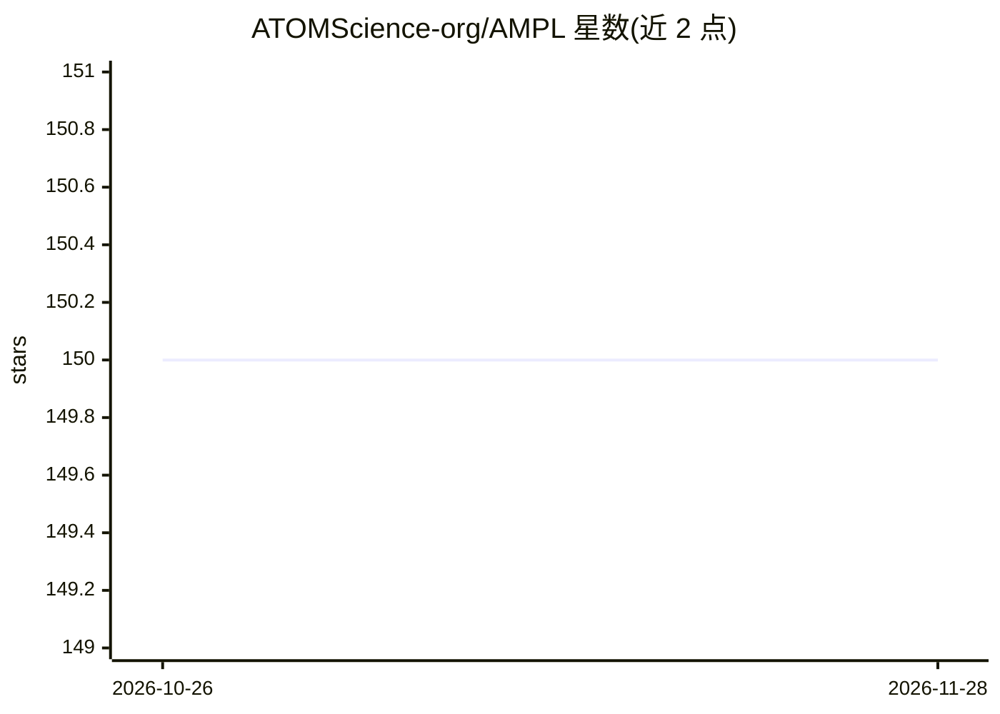

# ATOMScience-org/AMPL

⭐ 150 · Jupyter Notebook · MIT · 推送 2026-11-20 · [GitHub](https://github.com/ATOMScience-org/AMPL) · 组织维护

**面向药物研发者的分子性质预测建模流水线**

AMPL 是 ATOM 联盟开发的开源模块化流水线，覆盖数据整理、分子特征化（ECFP/图卷积/Mordred 描述符）、模型训练调优（随机森林、XGBoost、全连接与图卷积神经网络）、可视化分析四阶段，用于预测分子活性、安全性与药代动力学相关参数，扩展自 DeepChem。提供 PyPI 包、多平台 uv 环境（cpu/cuda/rocm/mchip）与 Docker 镜像，附文字、Jupyter notebook 与视频教程。MOE 描述符需商业许可；model_tracker 的 atomsci.clients 仅限 LLNL 用户。

## 筛选速览

| 维度 | 判定 | 备注 |
|---|---|---|
| AI 角色 | `ai-native` | 本体是模型或模型工具 |
| 许可风险 | `permissive` | MIT |
| 部署形态 | `self-host` | docker 或自建部署 |
| 模型依赖 | — | README 未给出锁定关系 |
| 硬件要求 | `cpu-ok` | |
| 安装摩擦 | `low` | 无编译、无系统依赖或容器化 |
| 成熟度 | — | 结构信号不足 |

## 能力要点

- 数据整理→特征化→模型训练调优→可视化分析的四阶段端到端流水线
- 支持 ECFP、DeepChem 图卷积向量、Mordred 与 MOE（需许可）四类分子特征化
- 支持 scikit-learn 随机森林、XGBoost、全连接神经网络、图卷积模型
- 提供 PyPI 安装、Docker 镜像（cpu/gpu/arm 平台）与教程系列

## 适用场景

- 构建分子活性与性质预测的机器学习模型
- 对小分子数据集做整理、特征化与基准测试
- 在 Jupyter notebook 中拟合模型并对新化合物做预测

## 场景标签

`模型训练` `科研工具` · 领域:学习与行业

## 证据(README 行号)

> L9: An open-source, end-to-end software pipeline for data curation, model building, and molecular property prediction to
> L15: The ATOM Modeling PipeLine (AMPL) extends the functionality of DeepChem and supports an array of machine learning a
> L292:  AMPL enables tasks for modeling and prediction from data ingestion to data analysis and can be broken down into t

## 星数曲线

2026-10-26 150 → 2026-11-28 150（+0）

---
*卡片 v1 · prompt 1.4 · 生成 2026-11-28 · 置信度 high · 依据 README sha `21cb44ae01ea` · [字段定义](../../DATASET.md)*
