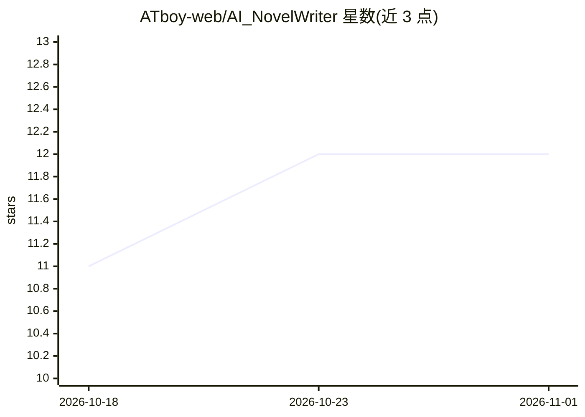

# ATboy-web/AI_NovelWriter

⭐ 12 · Python · NOASSERTION · 推送 2026-09-18 · [GitHub](https://github.com/ATboy-web/AI_NovelWriter) · 个人维护 · 中文 README

**AI 长篇小说创作工坊：5 Agent 协作自动生成与管理小说**

面向小说作者的桌面创作应用：Windows 单文件 EXE（另有 Android 应用、FastAPI 后端集群与 React Web 前端），通过 PlotDesigner→WorldBuilder→Writer→Reviewer→Editor 五个 Agent 协作，自动生成大纲、角色与章节，并以 18 个面板工作台精修设定、时间线、角色传记与世代传承。内置 135 类题材、世界线分支、插件与 MCP 接入。多 AI 服务适配（Ollama 本地/OpenAI 兼容/Anthropic/DeepSeek/智谱 GLM/Qwen/Kimi），带 token 归因与成本估算。限制：桌面端仅支持 Windows 10/11，需自配 AI 服务（本地 Ollama 或云端 API Key）。

## 筛选速览

| 维度 | 判定 | 备注 |
|---|---|---|
| AI 角色 | `ai-native` | 本体是模型或模型工具 |
| 许可风险 | `none` | NOASSERTION |
| 部署形态 | `desktop` | 安装包/桌面程序 |
| 模型依赖 | local-ok | 支持本地模型 |
| 硬件要求 | — | 无带数字的原话,不猜 |
| 安装摩擦 | `low` | 无编译、无系统依赖或容器化 |
| 成熟度 | — | 结构信号不足 |

## 能力要点

- 5 Agent 协作：大纲→角色→章节全自动生成与多轮迭代修订
- 18 面板工作台：创作素材、结构分析、世界线与世代传承等 5 分组
- 多 AI 服务 Provider 注册表与适配器，token 归因与成本统计
- 插件中心（AST 静态体检安全默认）与 MCP 客户端/服务端接入

## 适用场景

- 让 AI 自动生成长篇小说的大纲、角色与章节并续写
- 在面板工作台中管理世界观、角色传记与世代传承设定
- 用本地 Ollama 离线创作并统计各服务商用量成本

## 场景标签

`AI 写作` `多智能体` · 领域:Agent 开发

## 证据(README 行号)

> L9: 基于 AI 的长篇小说创作工坊 —— **135 类内置题材（可自定义）**、**5 Agent 协作**、
> L31: 4. 点击 **自动创作**：大纲 → 角色 → 章节全自动生成
> L117: - **Provider 注册表 + 适配器**：Ollama（本地）/ OpenAI 兼容接口 / Anthropic / DeepSeek /

## 星数曲线

2026-10-18 11 → 2026-11-01 12（+1）

---
*卡片 v1 · prompt 1.4 · 生成 2026-11-01 · 置信度 high · 依据 README sha `6f8b60ad5395` · [字段定义](../../DATASET.md)*
