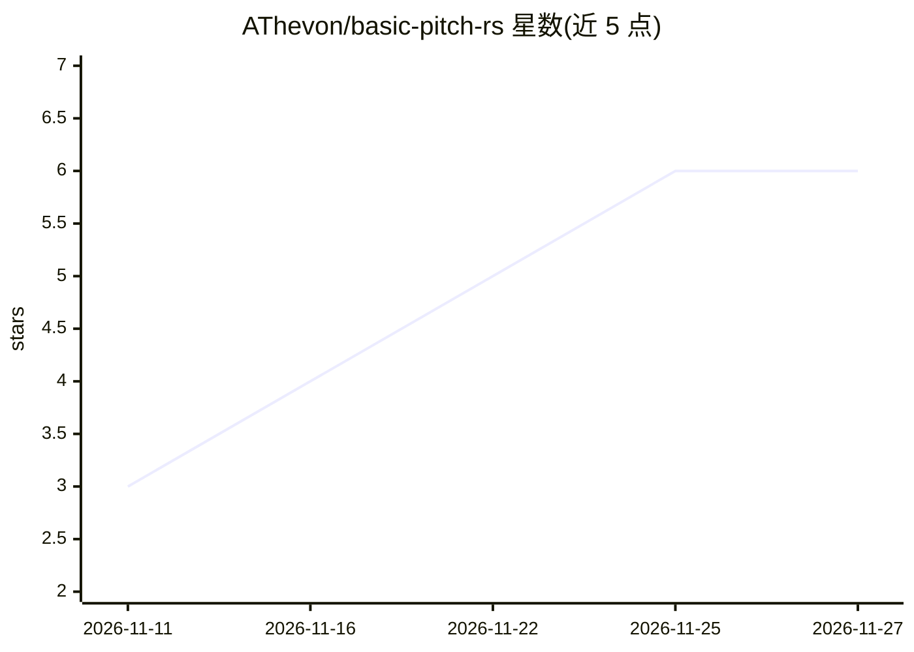

# AThevon/basic-pitch-rs

⭐ 6 · Rust · Apache-2.0 · 推送 2026-11-23 · [GitHub](https://github.com/AThevon/basic-pitch-rs) · [官网](https://athevon.github.io/basic-pitch-rs/) · 个人维护

**Rust 版 Basic Pitch：音频转 MIDI 多音高转录工具**

Spotify Basic Pitch 的非官方 Rust 移植：读取 WAV/AIFF/CAF/FLAC/MP3/Ogg/M4A/MOV 音频，运行官方 nmp.onnx 模型（默认内嵌，tract 纯 Rust 推理，可选 ONNX Runtime 后端），输出带弯音的 MIDI/JSON/CSV/NumPy。提供 Rust 库、CLI 与 WebAssembly 模块三种形态；每个流水线阶段与 Python 参考实现做逐值一致性测试，1650 条测试音符逐音符对齐。最低 Rust 1.91，Apache-2.0。

## 筛选速览

| 维度 | 判定 | 备注 |
|---|---|---|
| AI 角色 | `ai-native` | 本体是模型或模型工具 |
| 许可风险 | `permissive` | Apache-2.0 |
| 部署形态 | `library` | 以包/库形式分发 |
| 模型依赖 | — | README 未给出锁定关系 |
| 硬件要求 | — | 无带数字的原话,不猜 |
| 安装摩擦 | `medium` | 含编译或系统依赖之一 |
| 成熟度 | — | 结构信号不足 |

## 能力要点

- 纯 Rust 推理，模型内嵌于二进制，无需 Python 与本地原生库
- CLI 支持 8 种音频输入与 MIDI/JSON/CSV/NumPy 输出
- 与 Python 实现逐阶段一致性测试（1650/1650 音符）
- 库可编译到 wasm32，浏览器内本地转录

## 适用场景

- 把人声或乐器录音转成带弯音的 MIDI 文件
- 在 Rust 项目中以库形式集成音频转录流水线
- 在浏览器中离线转录音频并下载 MIDI

## 场景标签

 · 领域:音频处理/音乐信息检索

## 证据(README 行号)

> L30: Basic Pitch is a lightweight neural network that turns a recording into notes with pitch
> L44: - **A complete command-line tool.** WAV, AIFF, CAF, FLAC, MP3, Ogg, M4A and MOV inputs,
> L47: - **Runs in the browser.** The library builds for `wasm32-unknown-unknown` without extra

## 星数曲线

2026-11-11 3 → 2026-11-27 6（+3）

---
*卡片 v1 · prompt 1.4 · 生成 2026-11-21 · 置信度 mid · 依据 README sha `86f84ba33eca` · [字段定义](../../DATASET.md)*
