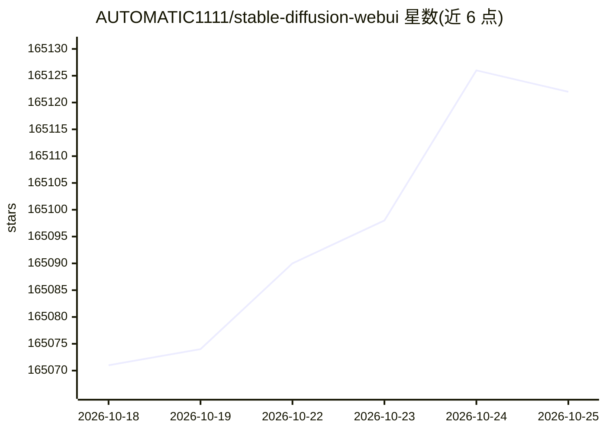

# AUTOMATIC1111/stable-diffusion-webui

⭐ 165,142 · Python · AGPL-3.0 · 推送 2026-03-02 · [GitHub](https://github.com/AUTOMATIC1111/stable-diffusion-webui) · 个人维护

**给创作者提供 Stable Diffusion 的浏览器图像生成界面**

基于 Gradio 实现的 Stable Diffusion Web 界面，提供 txt2img 与 img2img 两种生成模式，附带外绘、内绘、提示词矩阵、放大（RealESRGAN/SwinIR 等）、Textual Inversion、Lora、检查点合并、批量处理、CLIP 反推提示词、API 等功能。通过一键脚本安装运行，支持 NVidia GPU、AMD GPU、Intel CPU/GPU 与 Ascend NPU，也给出 Windows/Linux/Apple Silicon 的安装说明；生成参数可保存于图像元数据中供还原。

## 筛选速览

| 维度 | 判定 | 备注 |
|---|---|---|
| AI 角色 | `ai-native` | 本体是模型或模型工具 |
| 许可风险 | `viral` | AGPL-3.0 |
| 部署形态 | `desktop` | 安装包/桌面程序 |
| 模型依赖 | — | README 未给出锁定关系 |
| 硬件要求 | — | 无带数字的原话,不猜 |
| 安装摩擦 | `low` | 无编译、无系统依赖或容器化 |
| 成熟度 | — | 结构信号不足 |

## 动量与使用信号

- 维护:`declining` — 距上次 push 230.0 天,年发版 0,430 位贡献者
- 涨星:近 1 天 **+6**(自 20261016 起算)
- 下载:GitHub Release 附件 累计 5,882,013(27 个 release)
- 平台:MACOS / WEB · 协议:—

## 能力要点

- txt2img 与 img2img 两种生成模式及内绘/外绘
- 集成 GFPGAN、CodeFormer、RealESRGAN 等修复与放大网络
- 生成参数写入 PNG/EXIF 元数据并可一键还原
- 提供 API 与社区扩展脚本机制

## 适用场景

- 在本地浏览器界面里用提示词生成和修改图像
- 对已有图片做内绘、外绘或放大修复
- 训练和使用 Textual Inversion 嵌入与 Lora
- 合并多个 Stable Diffusion 检查点模型

## 场景标签

`图像生成` `图像视频处理` · 领域:内容生成

## 证据(README 行号)

> L2: A web interface for Stable Diffusion, implemented using Gradio library.
> L96: - NVidia (recommended)

## 星数曲线

2026-10-18 165,071 → 2026-10-25 165,122（+51）

---
*卡片 v1 · prompt 1.4 · 生成 2026-10-18 · 置信度 high · 依据 README sha `108bf7e29c09` · [字段定义](../../DATASET.md)*
