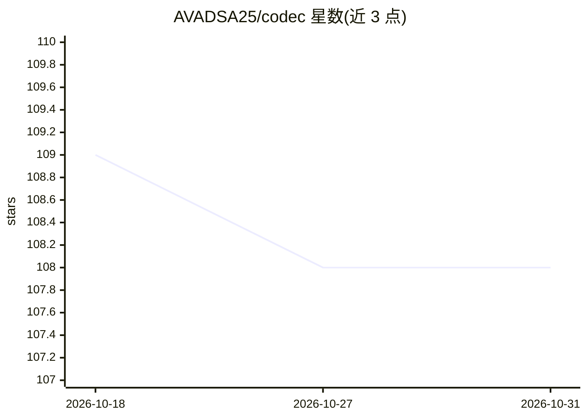

# AVADSA25/codec

⭐ 108 · Python · MIT · 推送 2026-10-30 · [GitHub](https://github.com/AVADSA25/codec) · [官网](https://opencodec.org/) · 组织维护

**macOS 语音控制的开源 AI 工作站，本地运行 7 个子产品**

将 Mac 变为完全本地运行的语音控制 AI 工作站：由 CODEC v3.5 引擎驱动，包含语音命令层（89 技能）、Whisper 听写、右键 AI 服务、250K 上下文聊天与 12 个多步 agent 小组、浏览器 IDE、实时语音通话及跨设备仪表盘。支持任意本地或云端 LLM，Whisper 做语音识别、Kokoro 做语音合成、UI-TARS 视觉模型实现纯视觉鼠标点击。可同时作为 MCP 客户端与服务器接入 Claude/Cursor/VS Code。MIT 许可，无云依赖。

## 筛选速览

| 维度 | 判定 | 备注 |
|---|---|---|
| AI 角色 | `ai-native` | 本体是模型或模型工具 |
| 许可风险 | `permissive` | MIT |
| 部署形态 | `library` | 以包/库形式分发 |
| 模型依赖 | local-ok | 支持本地模型 |
| 硬件要求 | — | 无带数字的原话,不猜 |
| 安装摩擦 | `low` | 无编译、无系统依赖或容器化 |
| 成熟度 | — | 结构信号不足 |

## 能力要点

- 语音命令 + 纯视觉 UI 点击控制（Whisper 转写 + UI-TARS 定位像素坐标）
- 89 个技能与 12 个多步 agent 小组，多 agent 运行时零外部框架依赖
- 既是 MCP 客户端也是 MCP 服务器，可被 Claude/Cursor/VS Code 反向驱动
- 新技能经人工审批流程落盘，全操作 16 类审计日志

## 适用场景

- 用语音操控 Mac 完成打字、点按、写代码、管理 Google Workspace
- 本地运行听写、翻译、润色等 AI 服务，数据不出机器
- 投递项目描述让 PM2 守护进程长时间自主执行任务
- 作为 MCP 工具把 Mac 的屏幕与应用暴露给其他 AI 客户端

## 场景标签

`语音 Agent` `多智能体` `语音识别` `GUI 自动化` · 领域:Agent 开发

## 证据(README 行号)

> L9:  CODEC turns a Mac into a voice-controlled AI workstation that runs 100% on your machine.
> L30: **Sovereign AI Workstation** turns a Mac into a voice-controlled AI workstation that you fully own. Give it a brain

## 星数曲线

2026-10-18 109 → 2026-10-31 108（-1）

---
*卡片 v1 · prompt 1.4 · 生成 2026-10-23 · 置信度 mid · 依据 README sha `66b8c99289e0` · [字段定义](../../DATASET.md)*
