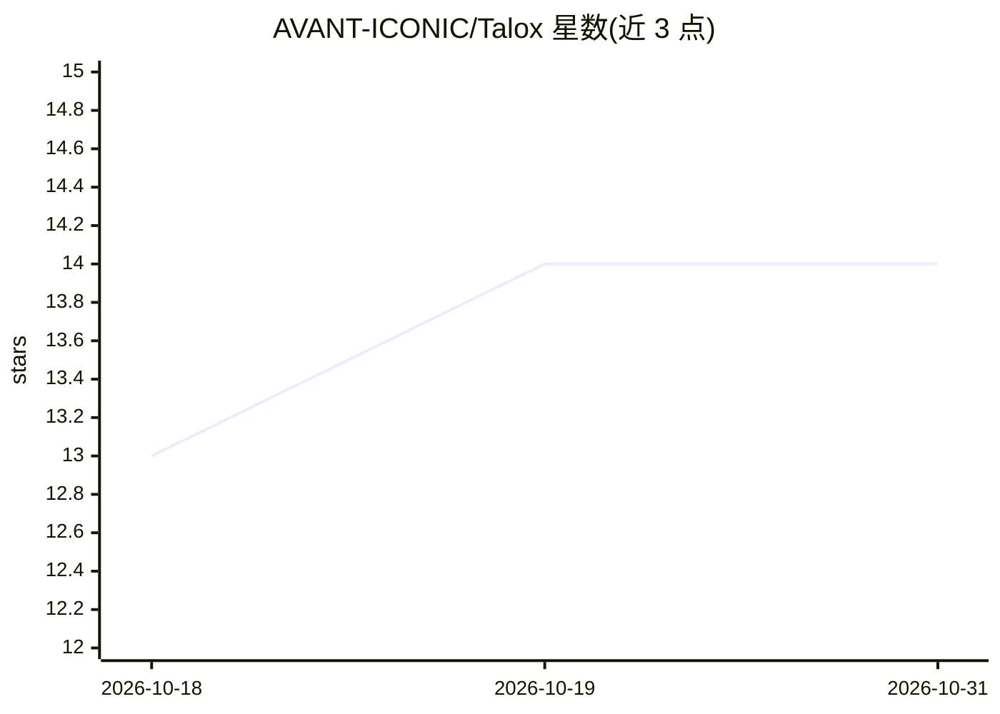

# AVANT-ICONIC/Talox

⭐ 14 · TypeScript · NOASSERTION · 推送 2026-10-16 · [GitHub](https://github.com/AVANT-ICONIC/Talox) · [官网](https://github.com/AVANT-ICONIC/Talox#readme) · 组织维护

**给 AI agent 的本地浏览器运行时：结构化状态+隐身交互**

基于 Playwright 的本地浏览器运行时，供 AI agent 在真实浏览器中执行任务。每个动作返回统一 JSON 契约（ARIA 语义、DOM 状态、控制台、网络事件、截图），内置拟人鼠标轨迹（贝塞尔曲线、Fitts 定律）、BotDetector、自愈选择器，并提供 agent 覆盖层供人类随时接管。支持 CLI、Node.js 脚本、OpenAI function calling、Anthropic prompt、MCP 桥接等接入方式；v6 起含 LLM 驱动的自主循环与按主机名复用的 SKILL.md 技能。npm 包尚未发布，需从 GitHub 克隆构建，依赖 Playwright Chromium。

## 筛选速览

| 维度 | 判定 | 备注 |
|---|---|---|
| AI 角色 | `ai-ecosystem` | LLM/agent 周边工具 |
| 许可风险 | `none` | NOASSERTION |
| 部署形态 | `library` | 以包/库形式分发 |
| 模型依赖 | — | README 未给出锁定关系 |
| 硬件要求 | — | 无带数字的原话,不猜 |
| 安装摩擦 | `low` | 无编译、无系统依赖或容器化 |
| 成熟度 | — | 结构信号不足 |

## 能力要点

- 每个动作返回单一结构化 JSON 状态契约（ARIA/控制台/网络/bugs/截图）
- 拟人化鼠标与 19 层 JS 隐身栈，BotDetector/自适应引擎默认常开
- agent 覆盖层支持人类暂停接管与 Markdown/HTML 会话工件
- 16 个 function-calling 工具兼容 OpenAI/Claude，另含 LLM 驱动自主循环与技能自学习

## 适用场景

- 让 LLM agent 在本地浏览器中执行网页操作并直接消费结构化页面状态
- 构建需要会话持久化与人类接管能力的浏览器自动化流程
- 调试 agent 浏览器交互，输出时间线、截图与 bug 汇总工件

## 场景标签

`浏览器自动化` · 领域:效率与自动化

## 证据(README 行号)

> L39: - **Talox = browser runtime** — Local-first, structured state, resilient interaction, and takeover-ready observabil
> L44: Talox is a **local browser runtime** — agents work inside a real browser with maximum stealth and human-like behavi
> L141: Talox ships as a flexible Node package with a CLI-first philosophy. The most efficient way to use Talox is through

## 星数曲线

2026-10-18 13 → 2026-10-31 14（+1）

---
*卡片 v1 · prompt 1.4 · 生成 2026-10-31 · 置信度 high · 依据 README sha `92e73a6c5771` · [字段定义](../../DATASET.md)*
