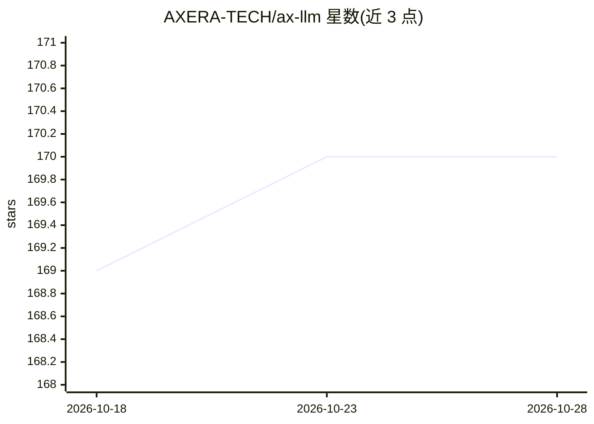

# AXERA-TECH/ax-llm

⭐ 170 · C++ · BSD-3-Clause · 推送 2026-10-26 · [GitHub](https://github.com/AXERA-TECH/ax-llm) · 组织维护 · 中文 README

**爱芯元智芯片上的 LLM/VLM 推理运行时，提供 OpenAI 兼容 API**

AX-LLM 由爱芯元智开发，用于探索 LLM/VLM 在 AXera AI 芯片（AX650A/AX650N/AX8850、AX637R、AX630C 等）上的部署，面向社区开发者做快速评估与二次开发。支持 Qwen、Llama3、MiniCPM、Gemma4、InternVL3.5 等文本与多模态模型，运行时输出单一可执行文件 axllm，含命令行对话与 serve 模式；serve 提供 OpenAI 兼容接口（对话、embedding、音频转写/翻译），兼容 vLLM/SGLang 扩展参数。通过安装脚本或 CI 产物/Docker 镜像分发；视频解码依赖服务端 ffmpeg；gemma-4 在 AXCL PCIe 后端存在已知数值发散问题。

## 筛选速览

| 维度 | 判定 | 备注 |
|---|---|---|
| AI 角色 | `ai-ecosystem` | LLM/agent 周边工具 |
| 许可风险 | `permissive` | BSD-3-Clause |
| 部署形态 | `self-host` | docker 或自建部署 |
| 模型依赖 | local-ok | 支持本地模型 |
| 硬件要求 | — | 无带数字的原话,不猜 |
| 安装摩擦 | `low` | 无编译、无系统依赖或容器化 |
| 成熟度 | — | 结构信号不足 |

## 能力要点

- 单可执行文件 axllm，支持 AX650 片上与 AXCL PCIe 两种后端
- serve 模式提供 OpenAI 兼容 /v1/chat/completions、/v1/embeddings、音频转写/翻译接口
- 支持图文/视频/音频多模态输入与多模态 Embedding
- 多槽前缀 KV 缓存与动态加载（按需加载权重降低 CMM 占用）

## 适用场景

- 在 AXera 边缘芯片上本地部署 LLM/VLM 模型
- 通过 OpenAI SDK 直接调用芯片侧推理服务
- 小内存设备上跑模型时用动态加载降低 CMM 占用
- 多用户共享前缀提示词时用多槽 KV 缓存加速

## 场景标签

`推理引擎` `多模态` · 领域:感知与多模态

## 证据(README 行号)

> L7: **AX-LLM** 由 **爱芯元智** 主导开发。该项目用于探索业界常用 **LLM(Large Language Model)** 在已有芯片平台上落地的可行性和相关能力边界，**方便**社区开发者进行**快速评估**和**二

## 星数曲线

2026-10-18 169 → 2026-10-28 170（+1）

---
*卡片 v1 · prompt 1.4 · 生成 2026-10-23 · 置信度 mid · 依据 README sha `b5ef7e6a3935` · [字段定义](../../DATASET.md)*
