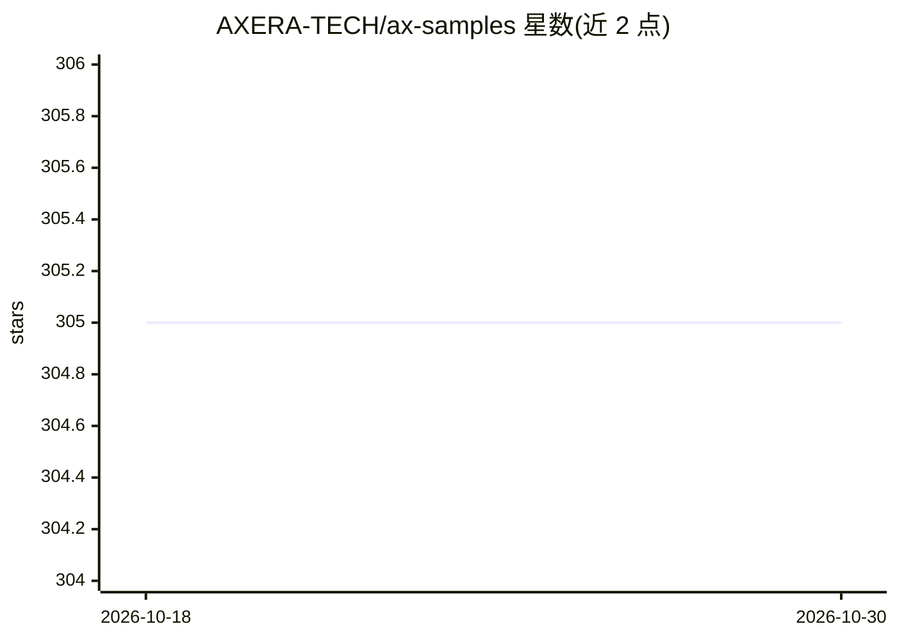

# AXERA-TECH/ax-samples

⭐ 305 · CMake · BSD-3-Clause · 推送 2026-10-13 · [GitHub](https://github.com/AXERA-TECH/ax-samples) · 组织维护 · 中文 README

**爱芯元智 AI SoC 上的深度学习算法示例代码集**

由爱芯元智主导开发的示例代码项目：将 YOLO 系列检测、分类、分割、姿态估计等常见深度学习开源算法在该公司 AI SoC（AX650/AX8850/AX630C 等 NPU 芯片）上实现，供社区开发者快速评估与适配。每个模型示例包含前处理、NPU 推理、后处理与结果保存；使用流程为 cmake 交叉编译、经 Pulsar2 转换或网盘获取 axmodel 模型、拷贝至开发板运行。另提供 ModelZoo、预编译程序、测试图片（HuggingFace/Modelscope）与基于 AXera-Pi Pro 的推理耗时 benchmark。

## 筛选速览

| 维度 | 判定 | 备注 |
|---|---|---|
| AI 角色 | `ai-ecosystem` | LLM/agent 周边工具 |
| 许可风险 | `permissive` | BSD-3-Clause |
| 部署形态 | `None` |  |
| 模型依赖 | — | README 未给出锁定关系 |
| 硬件要求 | — | 无带数字的原话,不猜 |
| 安装摩擦 | `medium` | 含编译或系统依赖之一 |
| 成熟度 | — | 结构信号不足 |

## 能力要点

- 覆盖终端/车载/边缘共 10 余款 AX 系列 AI SoC 芯片
- 示例结构：前处理 → NPU 推理 → 后处理 → 保存结果图
- 提供 ModelZoo、预编译程序与测试图片的网盘资源
- 基于 AXera-Pi Pro 的常见模型推理耗时统计

## 适用场景

- 在爱芯元智开发板上评估 YOLO 等 CV 模型的 NPU 推理
- 将自己的深度学习模型适配到 AX 系列 AI SoC
- 对比常见开源模型在边缘芯片上的推理耗时

## 场景标签

`目标检测` `推理引擎` · 领域:感知与多模态

## 证据(README 行号)

> L17: **AX-Samples** 由 **爱芯元智** 主导开发。该项目实现了常见的 **深度学习开源算法** 在 **爱芯元智** 的 **AI SoC** 上的示例代码，方便社区开发者进行快速评估和适配。
> L56: ├── ax_<模型>_steps.cc     # 每个模型一个示例：前处理 → NPU 推理 → 后处理 → 保存结果图

## 星数曲线

2026-10-18 305 → 2026-10-30 305（+0）

---
*卡片 v1 · prompt 1.4 · 生成 2026-10-22 · 置信度 high · 依据 README sha `039a71e5d373` · [字段定义](../../DATASET.md)*
