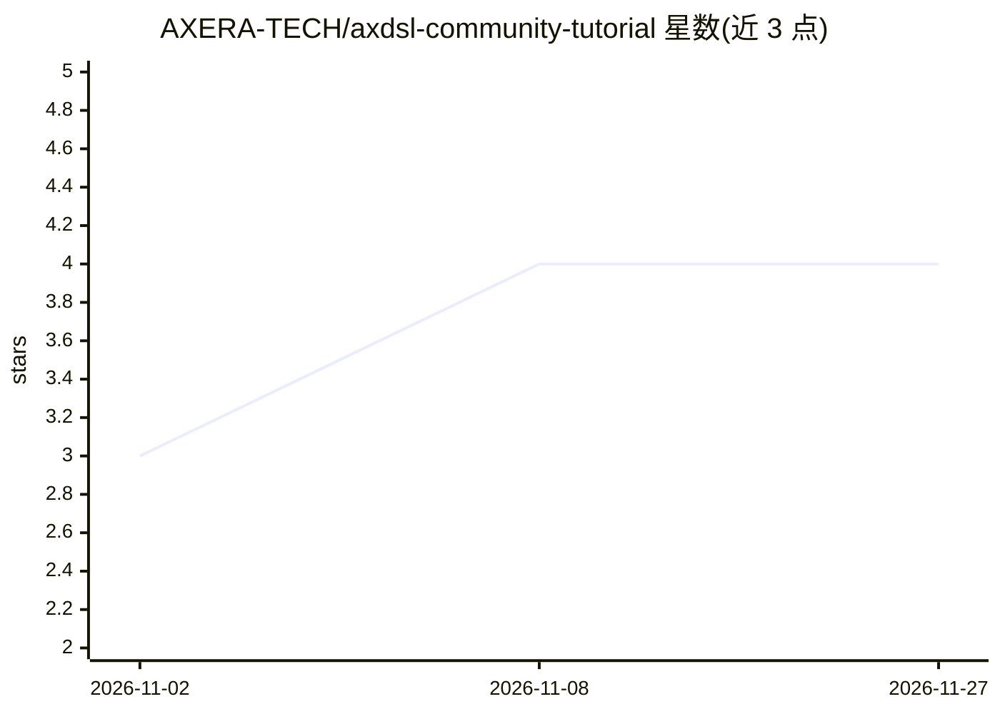

# AXERA-TECH/axdsl-community-tutorial

⭐ 4 · Python · BSD-3-Clause · 推送 2026-11-09 · [GitHub](https://github.com/AXERA-TECH/axdsl-community-tutorial) · 组织维护 · 中文 README

**面向 AX8860 NPU 开发者的中文 AXDSL 教程站**

基于 VitePress 构建的中文教程站点，讲解如何用 Python DSL 在 AX8860 NPU 上编写高性能自定义内核。内容涵盖入门与核心原理、API Reference（由源码 docstring 生成）、vector_add/tiled_matmul/fused_silu_mul 等示例代码；示例需在 AXNN 工具链仓库环境下设置 PYTHONPATH 运行。支持本地开发、构建预览，并可通过 GitHub Actions 与 Read the Docs 自动发布在线文档。注意：ax.builder 的 auto_tune_cases 能力暂不承诺，dtype/shape 支持矩阵待补充。

## 筛选速览

| 维度 | 判定 | 备注 |
|---|---|---|
| AI 角色 | `ai-knowledge` | 知识聚合/清单类 |
| 许可风险 | `permissive` | BSD-3-Clause |
| 部署形态 | `None` |  |
| 模型依赖 | — | README 未给出锁定关系 |
| 硬件要求 | — | 无带数字的原话,不猜 |
| 安装摩擦 | `low` | 无编译、无系统依赖或容器化 |
| 成熟度 | — | 结构信号不足 |

## 能力要点

- 中文 AXDSL 教程，基于 VitePress 构建，托管于 Read the Docs
- API Reference 由 AXNN 源码 docstring 脚本生成
- 附带 vector_add、tiled_matmul、fused_silu_mul 等示例代码
- GitHub Actions 自动构建发布流程

## 适用场景

- 学习如何在 AX8860 NPU 上用 DSL 编写自定义内核
- 查阅 AXDSL 算子 API Reference
- 为 NPU 工具链搭建社区文档站参考发布流程

## 场景标签

`教程课程` · 领域:学习与行业

## 证据(README 行号)

> L7: 面向 AX8860 NPU 的中文 AXDSL 教程，基于 VitePress 构建。
> L45: ├── index.md                     首页与学习路径
> L46: ├── guide/                       入门与核心原理

## 星数曲线

2026-11-02 3 → 2026-11-27 4（+1）

---
*卡片 v1 · prompt 1.4 · 生成 2026-11-22 · 置信度 high · 依据 README sha `3767c385c566` · [字段定义](../../DATASET.md)*
