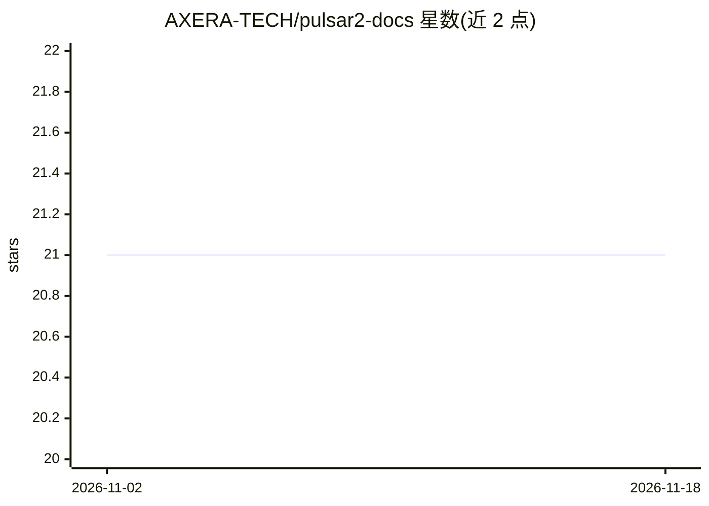

# AXERA-TECH/pulsar2-docs

⭐ 21 · JavaScript · BSD-3-Clause · 推送 2026-11-06 · [GitHub](https://github.com/AXERA-TECH/pulsar2-docs) · 组织维护 · 中文 README

**爱芯元智 Pulsar2 AI 工具链的官方用户手册文档**

AXERA-TECH 维护的 Pulsar2 工具链使用手册公共文档仓库，面向该 AI 工具链的开发者与使用者，目标是统一文档展示地址、降低维护成本与学习成本。文档基于 Sphinx 搭建，本地运行需 git clone 后 pip 安装依赖，通过 make html 编译，再用浏览器或 Python 启动的 HTTP 服务预览。工具链本身面向 AX8860、AX8850、AX8910、AX630C、AX620Q、AX615 等 SoC。

## 筛选速览

| 维度 | 判定 | 备注 |
|---|---|---|
| AI 角色 | `ai-knowledge` | 知识聚合/清单类 |
| 许可风险 | `permissive` | BSD-3-Clause |
| 部署形态 | `library` | 以包/库形式分发 |
| 模型依赖 | — | README 未给出锁定关系 |
| 硬件要求 | — | 无带数字的原话,不猜 |
| 安装摩擦 | `low` | 无编译、无系统依赖或容器化 |
| 成熟度 | — | 结构信号不足 |

## 能力要点

- Pulsar2 AI 工具链的公共维护使用手册
- 基于 Sphinx 搭建，make html 编译生成 HTML 文档
- 覆盖 AX8860/AX8850/AX8910/AX630C/AX620Q/AX615 等 SoC

## 适用场景

- 查阅 Pulsar2 工具链的使用方法与配置说明
- 本地编译并预览文档进行贡献或离线阅读
- 了解爱芯元智 SoC 的 AI 工具链文档结构

## 场景标签

`教程课程` `模型量化` · 领域:学习与行业

## 证据(README 行号)

> L7: 新一代 AI 工具链 *Pulsar2* 使用手册公共维护项目
> L10: - 降低 AI 工具链 Developer 维护成本

## 星数曲线

2026-11-02 21 → 2026-11-18 21（+0）

---
*卡片 v1 · prompt 1.4 · 生成 2026-11-18 · 置信度 mid · 依据 README sha `974813f4d185` · [字段定义](../../DATASET.md)*
