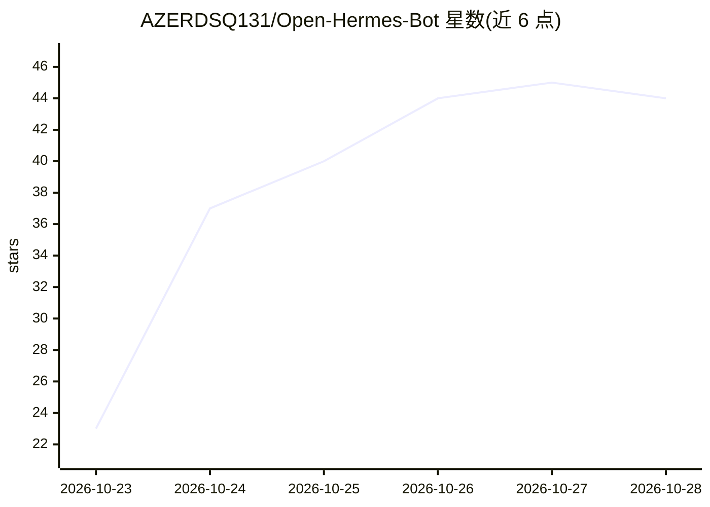

# AZERDSQ131/Open-Hermes-Bot

⭐ 44 · TypeScript · NOASSERTION · 推送 2026-10-24 · [GitHub](https://github.com/AZERDSQ131/Open-Hermes-Bot) · [官网](https://azerdsq131.github.io/Open-Hermes-Bot/) · 个人维护

**连接 Hermes 多 agent 运行时的 macOS 原生聊天界面**

基于 Electron/React 的 macOS 桌面客户端，为自托管 Hermes agent 运行时提供聊天界面：深色侧栏、bot 头像、群组会话与浮动输入框。本机不运行模型、不保存对话，所有会话、记忆与工具执行都在 Hermes 宿主机上（本机或经 SSH 隧道的远端），API key 存入登录钥匙串。支持群组多 bot 并行应答、@提及、静默确认、模型选择与配额耗尽自动切换。提供 dmg 安装包（arm64/x64，ad-hoc 签名需手动清除隔离属性）与 npm 源码运行方式，另有 Expo 移动端目录。

## 筛选速览

| 维度 | 判定 | 备注 |
|---|---|---|
| AI 角色 | `ai-ecosystem` | LLM/agent 周边工具 |
| 许可风险 | `none` | NOASSERTION |
| 部署形态 | `desktop` | 安装包/桌面程序 |
| 模型依赖 | — | README 未给出锁定关系 |
| 硬件要求 | — | 无带数字的原话,不猜 |
| 安装摩擦 | `low` | 无编译、无系统依赖或容器化 |
| 成熟度 | — | 结构信号不足 |

## 能力要点

- 对话完全存放于 Hermes 宿主机，本机不保存任何会话数据
- 群组会话中各成员经独立 profile 并行应答，含 @提及与静默确认机制
- 模型配额耗尽时自动在同 provider 的免费模型上重试
- dmg 双架构安装包 + 自动更新，需 xattr 清除 Gatekeeper 隔离

## 适用场景

- 在 Mac 上与本机或远端 Hermes agent 进行私聊与群聊
- 通过 SSH 隧道连接另一台机器上的 Hermes 宿主机
- 给已有 Hermes 部署配一个图形聊天前端

## 场景标签

`聊天机器人` · 领域:对话与助手

## 证据(README 行号)

> L21: This app is an **interface for Hermes**. It is not a harness.
> L24: conversations, executes the tools and calls the models. This app is the macOS
> L28: So the app runs no model and keeps no transcript: the conversation lives on the

## 星数曲线

2026-10-23 23 → 2026-10-28 44（+21）

---
*卡片 v1 · prompt 1.4 · 生成 2026-10-25 · 置信度 high · 依据 README sha `fbebf63e9ae9` · [字段定义](../../DATASET.md)*
