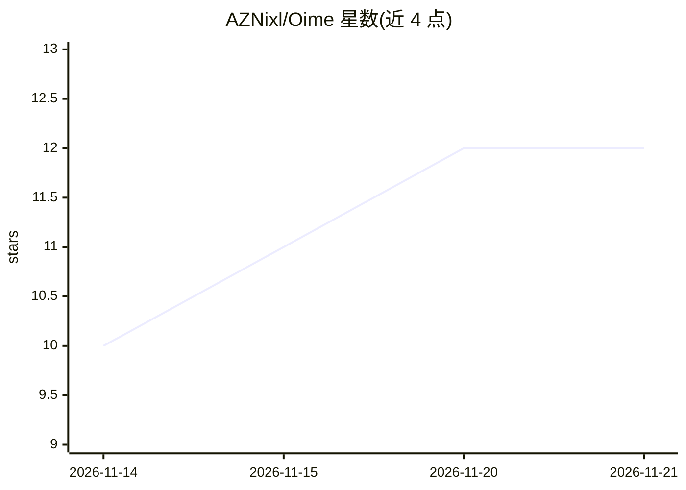

# AZNixl/Oime

⭐ 12 · Kotlin · GPL-3.0 · 推送 2026-10-29 · [GitHub](https://github.com/AZNixl/Oime) · [官网](https://github.com/AZNixl/Oime/releases/latest) · 个人维护 · 中文 README

**给 Android 用户的 RIME 输入法：方案即放即用，带离线语音与 AI 输入**

基于 librime 引擎与 Jetpack Compose 自绘键盘的 Android 输入法（Android 6.0+，arm64-v8a 与 armeabi-v7a 独立出包）。支持 26 键/九宫格/十四键布局、可视化键位编辑、四向手势与 ○ 圆环手势操作；RIME 方案组零拷贝加载，虎码、双拼、白霜等放入 schemas 目录即用。语音输入含 SenseVoice 与流式 zipformer 两个离线引擎，也可配置豆包、阿里云百炼、OpenAI 等服务做整段转写或实时流式听写。AI 输入提供翻译、续写、润色、对话，文本发往用户自配的提供商；默认全离线、无遥测，密钥只存本机不进备份。发行版从 Releases 下载 APK，构建依赖 GitHub Actions（需 JDK 17）。

## 筛选速览

| 维度 | 判定 | 备注 |
|---|---|---|
| AI 角色 | `ai-enhanced` | 去掉 AI 部分产品仍成立 |
| 许可风险 | `viral` | GPL-3.0 |
| 部署形态 | `None` |  |
| 模型依赖 | — | README 未给出锁定关系 |
| 硬件要求 | — | 无带数字的原话,不猜 |
| 安装摩擦 | `medium` | 含编译或系统依赖之一 |
| 成熟度 | `idea` | |

## 能力要点

- librime 方案组零拷贝架构，虎码/白霜等方案放入目录即用
- 离线语音：SenseVoice（中英日韩粤 int8 模型）与流式 zipformer
- AI 输入：翻译/续写/润色/对话，支持智谱、百炼、OpenAI、Kimi、DeepSeek 等
- 可视化键位编辑器与四向手势，三种界面风格（Material/Miuix/One UI）

## 适用场景

- 在 Android 上使用虎码、白霜等 RIME 方案打字
- 离线语音输入，或配置豆包/百炼等做实时流式听写
- 打字过程中让 AI 边打边翻译或续写润色
- 对隐私有要求，希望输入全程默认不出本机

## 场景标签

`语音识别` · 领域:感知与多模态

## 证据(README 行号)

> L3: **Android RIME 输入法** —— librime 引擎 + Jetpack Compose 声明式键盘（键面、图标与 ○ 圆环为手绘），方案组零拷贝架构，支持本地语音识别与 AI 输入（翻译 / 续写 / 润色 / 对
> L74: - **SenseVoice（离线）** —— 本地 int8 模型，中 / 英 / 日 / 韩 / 粤，松手出全文
> L91: - **AI 提供商**：与联网语音共用 Key，支持智谱、百炼、硅基流动、阶跃、OpenAI、Kimi、DeepSeek；模型可自动拉取或手填

## 星数曲线

2026-11-14 10 → 2026-11-21 12（+2）

---
*卡片 v1 · prompt 1.4 · 生成 2026-11-19 · 置信度 high · 依据 README sha `a6a7cbecaef6` · [字段定义](../../DATASET.md)*
