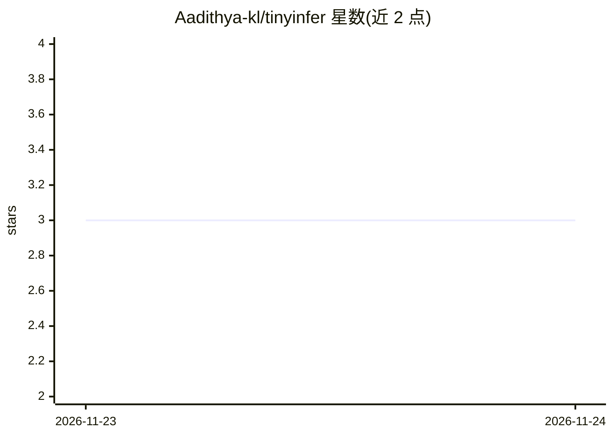

# Aadithya-kl/tinyinfer

⭐ 4 · C++ · MIT · 推送 2026-11-14 · [GitHub](https://github.com/Aadithya-kl/tinyinfer) · 个人维护

**从零手写 CUDA 内核的 Llama 系推理引擎，可在笔记本 GPU 上本地运行**

用约 2,200 行 C++/CUDA 实现的 Llama 家族模型推理引擎，不依赖 PyTorch 与 cuBLAS。热路径内核全部手写并与 CPU 参考实现对拍，参考实现再与 HuggingFace transformers 核验（logits 相对误差约 1e-3）。支持 f16/INT8/INT4 分组权重量化、flash-decoding attention、GQA 与 CUDA Graph 回放解码；.tinf 单文件封装配置、tokenizer 与权重。README 记录 RTX 3050 6GB 笔记本 GPU 上 TinyLlama q4 达 235 tok/s。需 NVIDIA Turing 及以上 GPU、CUDA Toolkit 12/13、CMake 编译；仅支持 Llama-2 家族 safetensors 检查点。

## 筛选速览

| 维度 | 判定 | 备注 |
|---|---|---|
| AI 角色 | `ai-ecosystem` | LLM/agent 周边工具 |
| 许可风险 | `permissive` | MIT |
| 部署形态 | `desktop` | 安装包/桌面程序 |
| 模型依赖 | — | README 未给出锁定关系 |
| 硬件要求 | — | 无带数字的原话,不猜 |
| 安装摩擦 | `high` | 编译与系统依赖俱全 |
| 成熟度 | — | 结构信号不足 |

## 能力要点

- 手写 f16/q8/q4 GEMV、RMSNorm、fused RoPE+KV 写入、flash-decoding attention 内核
- 分组 INT8/INT4 权重量化，TinyLlama-1.1B 约 0.7 GB、Llama-2-7B 约 3.8 GB 可在 6 GB GPU 运行
- CUDA Graph 一次捕获整个解码步并每 token 回放
- GPU 内核与 CPU 参考实现逐单元对拍，端到端与 transformers logits 核验

## 适用场景

- 在无 PyTorch 环境的笔记本 GPU 上本地运行 TinyLlama/Llama-2/Vicuna 对话模型
- 学习 CUDA 内核优化（GEMV、attention、CUDA Graph）的可读参考实现
- 对 Llama-2 家族 safetensors 检查点做 q4/q8 量化本地推理

## 场景标签

`推理引擎` `模型量化` · 领域:训练与推理

## 证据(README 行号)

> L3: **A from-scratch CUDA inference engine for Llama-family LLMs. Hand-written kernels, INT4/INT8 weight quantization, C
> L14: Tinyinfer runs chat models such as TinyLlama-1.1B, Llama-2-7B and Vicuna on a laptop GPU. It is
> L57: - **Cross-platform.** Windows (MSVC) and Linux (GCC), CUDA 12 and 13, GPUs from sm_75 (Turing) up.

## 星数曲线

2026-11-23 3 → 2026-11-24 3（+0）

---
*卡片 v1 · prompt 1.4 · 生成 2026-11-23 · 置信度 mid · 依据 README sha `eeaa2d116442` · [字段定义](../../DATASET.md)*
