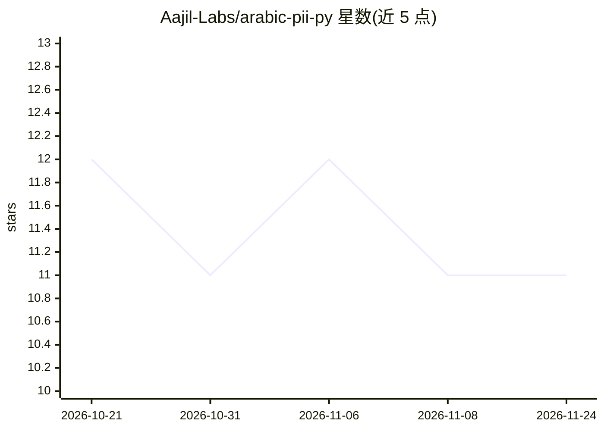

# Aajil-Labs/arabic-pii-py

⭐ 11 · Python · Apache-2.0 · 推送 2026-05-31 · [GitHub](https://github.com/Aajil-Labs/arabic-pii-py) · [官网](https://labs.aajil.sa) · 组织维护

**为使用阿语/海湾文档的团队提供本地可逆 PII 脱敏**

apii 是运行在本地的隐私层：用正则、校验位（ISO-7064 IBAN、国家 ID 校验位）与 int8 ONNX NER 检测阿语/英语文本中的姓名、国家 ID、IBAN、电话、VAT、工商注册号、邮箱、地址，替换为可逆 HMAC 令牌后再送模型；真实值存于本地 ChaCha20-Poly1305 加密 vault，回复返回后在本地还原。提供 CLI、本地代理（apii serve）、Claude Code hook、Agent Skill 四种接入方式，令牌确定性映射使模型可推理"同一客户"而不见真值。

## 筛选速览

| 维度 | 判定 | 备注 |
|---|---|---|
| AI 角色 | `ai-ecosystem` | LLM/agent 周边工具 |
| 许可风险 | `permissive` | Apache-2.0 |
| 部署形态 | `library` | 以包/库形式分发 |
| 模型依赖 | local-ok | 支持本地模型 |
| 硬件要求 | — | 无带数字的原话,不猜 |
| 安装摩擦 | `medium` | 含编译或系统依赖之一 |
| 成熟度 | — | 结构信号不足 |

## 能力要点

- 本地可逆令牌化：HMAC-SHA256 确定性映射 + 加密 vault，仅令牌出机
- 面向阿拉伯语原生设计：阿语姓名、阿拉伯-印度数字、RTL 文本与六国 GCC 标识符校验
- 四种接入：CLI/库、本地代理（OpenAI Chat/Responses、Anthropic Messages 三种线格式）、Claude Code hook、Agent Skill
- 纯 Python 无 PyTorch，支持带本地模型完全离线运行

## 适用场景

- 在遵守数据不出境要求的前提下让客户数据可送入 LLM 处理
- 对整个文件夹的报表/账单批量脱敏并保留版式
- 在 Claude Code 中自动对读写文件做脱敏与还原
- 审计检测文本中的阿语 PII 而不修改原文

## 场景标签

 · 领域:数据隐私/LLM 基础设施

## 证据(README 行号)

> L7: `apii` is a local privacy layer. It finds the sensitive data in your text — names, national IDs, IBANs, phone number
> L72: One port speaks three wire formats — OpenAI Chat, OpenAI Responses (what Codex uses), and Anthropic Messages — so i
> L169: |`apii serve`|Local anonymizing LLM proxy — `/v1/messages`, `/v1/chat/completions`, `/v1/responses` (needs `[proxy

## 星数曲线

2026-10-21 12 → 2026-11-24 11（-1）

---
*卡片 v1 · prompt 1.4 · 生成 2026-11-19 · 置信度 high · 依据 README sha `88422510c8eb` · [字段定义](../../DATASET.md)*
