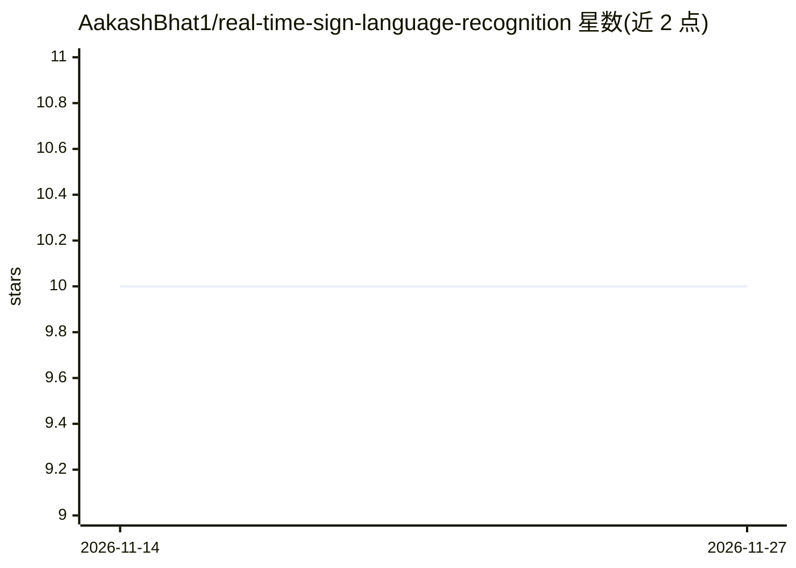

# AakashBhat1/real-time-sign-language-recognition

⭐ 10 · Python · 推送 2025-12-26 · [GitHub](https://github.com/AakashBhat1/real-time-sign-language-recognition) · 个人维护

**为听障沟通场景做实时手语手势识别的 ML 系统**

端到端手语识别系统：collectdata.py 采集手势数据，data.py 做预处理与特征提取，trainmodel.py 训练模型并以 JSON 存储，app.py 加载模型对新输入做实时预测。技术栈为 Python，搭配 Scikit-learn/TensorFlow、NumPy/Pandas。目标用户为希望复现或扩展手部手势识别流程的开发者与学习者。仓库不含训练/测试所用图像数据集，需自行采集数据后训练。

## 筛选速览

| 维度 | 判定 | 备注 |
|---|---|---|
| AI 角色 | `ai-native` | 本体是模型或模型工具 |
| 许可风险 | `none` | — |
| 部署形态 | `library` | 以包/库形式分发 |
| 模型依赖 | — | README 未给出锁定关系 |
| 硬件要求 | — | 无带数字的原话,不猜 |
| 安装摩擦 | `low` | 无编译、无系统依赖或容器化 |
| 成熟度 | — | 结构信号不足 |

## 能力要点

- 端到端 ML 流程：数据采集、预处理、训练、存储、实时预测
- 模块化 Python 脚本划分各流程阶段
- 训练好的模型以 JSON 文件持久化并供 app.py 加载复用

## 适用场景

- 采集并训练自己的手部手势识别模型
- 实时识别手语手势并输出分类结果
- 作为机器学习分类流程的教学示例项目

## 场景标签

`目标检测` · 领域:感知与多模态

## 证据(README 行号)

> L1: This project is a machine learning–based Sign Language Recognition system designed to identify hand gestures and cla
> L51: app.py loads the trained model and performs predictions on new inputs

## 星数曲线

2026-11-14 10 → 2026-11-27 10（+0）

---
*卡片 v1 · prompt 1.4 · 生成 2026-11-20 · 置信度 high · 依据 README sha `d2cd1018c82c` · [字段定义](../../DATASET.md)*
