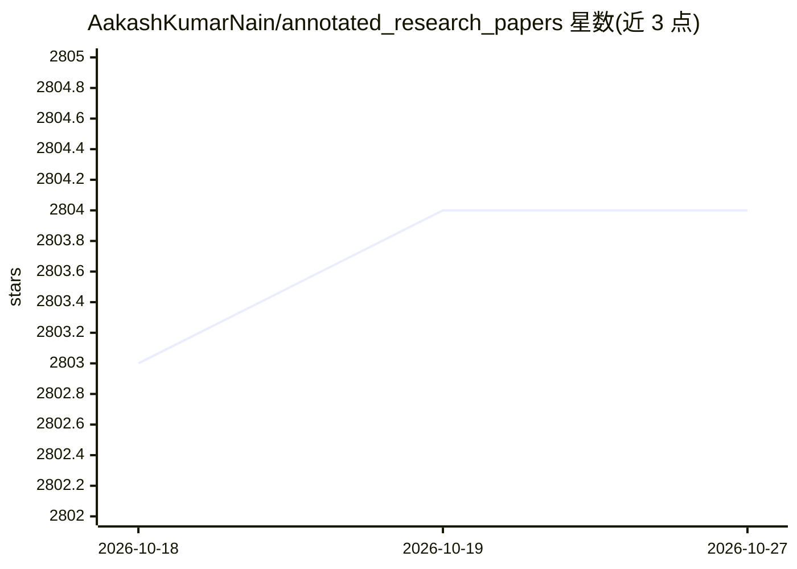

# AakashKumarNain/annotated_research_papers

⭐ 2,804 · MIT · 推送 2026-08-29 · [GitHub](https://github.com/AakashKumarNain/annotated_research_papers) · 个人维护

**深度学习研究论文的批注共享库，帮助读者理解论文**

个人维护的机器学习/深度学习研究论文批注集合：作者以手写/纸笔式的批注方式分享阅读论文的思考过程，将论文按目录组织，并接受社区按统一指南贡献的批注论文。面向想阅读论文但觉得困难的研究者与 ML 工程师，用于降低论文阅读门槛并跟进领域进展。仓库本身为内容集合，无安装或运行组件。

## 筛选速览

| 维度 | 判定 | 备注 |
|---|---|---|
| AI 角色 | `ai-knowledge` | 知识聚合/清单类 |
| 许可风险 | `permissive` | MIT |
| 部署形态 | `None` |  |
| 模型依赖 | — | README 未给出锁定关系 |
| 硬件要求 | — | 无带数字的原话,不猜 |
| 安装摩擦 | `low` | 无编译、无系统依赖或容器化 |
| 成熟度 | — | 结构信号不足 |

## 能力要点

- 以批注形式分享作者阅读论文的思考过程
- 按目录组织的论文批注集合
- 社区贡献部分附有统一批注指南

## 适用场景

- 阅读论文时参考他人批注以降低理解门槛
- 跟进深度学习领域的论文阅读清单
- 按统一指南贡献自己的批注论文

## 场景标签

`教程课程` · 领域:学习与行业

## 证据(README 行号)

> L1: # Annotate Research Papers
> L7: Do you love reading research papers? Or do you want to read more research papers but find them intimidating? Or are 

## 星数曲线

2026-10-18 2,803 → 2026-10-27 2,804（+1）

---
*卡片 v1 · prompt 1.4 · 生成 2026-10-21 · 置信度 high · 依据 README sha `da09be9d9220` · [字段定义](../../DATASET.md)*
