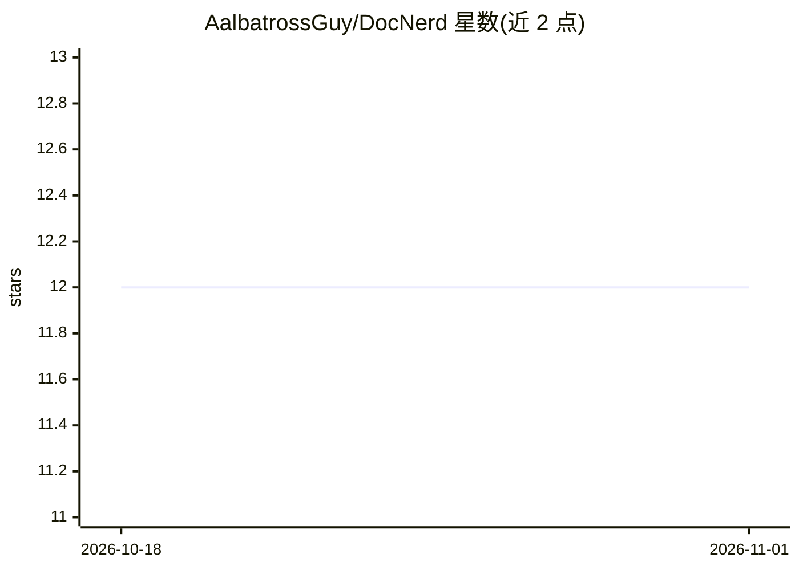

# AalbatrossGuy/DocNerd

⭐ 12 · Python · GPL-2.0 · 推送 2025-11-21 · [GitHub](https://github.com/AalbatrossGuy/DocNerd) · 个人维护

**AI 文档字符串生成器：为多语言代码自动生成 docstring**

命令行工具，调用 Groq API（GROQ_API_KEY）为代码文件生成 docstring，支持 Python、Rust、C 及其头文件、C++ 及其头文件、JavaScript、TypeScript 与 Java。使用时需在目标代码中用 DOCSTRING START/END 标记包裹目标区域，通过 python3 docnerd.py 运行，可选 --replace-existing-docstring 参数覆写已有 docstring。安装方式为 git clone 源码并配置 .env 中的 API key。

## 筛选速览

| 维度 | 判定 | 备注 |
|---|---|---|
| AI 角色 | `ai-native` | 本体是模型或模型工具 |
| 许可风险 | `viral` | GPL-2.0 |
| 部署形态 | `None` |  |
| 模型依赖 | locked-api |  |
| 硬件要求 | — | 无带数字的原话,不猜 |
| 安装摩擦 | `low` | 无编译、无系统依赖或容器化 |
| 成熟度 | — | 结构信号不足 |

## 能力要点

- 支持 8 种语言/文件类型的 docstring 生成
- 基于 DOCSTRING START/END 标记选取生成区域
- 提供 --replace-existing-docstring 覆写已有 docstring

## 适用场景

- 为已有函数批量补充 docstring
- 覆写项目中风格不一的旧 docstring

## 场景标签

`代码生成` · 领域:编码与开发

## 证据(README 行号)

> L2: An AI docstring generator because I find writing docstrings a big bore. Now has support for Python, Rust, C & it's h
> L11: 2. Set `GROQ_API_KEY=<api-key>` in `.env` or `export GROQ_API_KEY=<api-key>`

## 星数曲线

2026-10-18 12 → 2026-11-01 12（+0）

---
*卡片 v1 · prompt 1.4 · 生成 2026-11-01 · 置信度 high · 依据 README sha `cf4bc784fbfd` · [字段定义](../../DATASET.md)*
