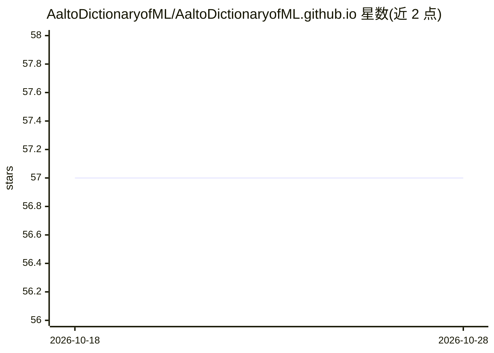

# AaltoDictionaryofML/AaltoDictionaryofML.github.io

⭐ 57 · TeX · NOASSERTION · 推送 2026-09-01 · [GitHub](https://github.com/AaltoDictionaryofML/AaltoDictionaryofML.github.io) · [官网](https://aaltodictionaryofml.github.io/) · 组织维护

**面向学生与研究者的多语机器学习术语词典（PDF+MCP）**

Aalto 大学机器学习组维护的开放获取机器学习/AI 术语表，含 567 个条目，覆盖 ML 概念（285）、数学工具（219）、ML 系统、监管、强化学习等类别。以英文 PDF 为主，提供西班牙语、德语、法语、希腊语、芬兰语翻译下载；同时以 MCP server 形式发布，可供 Claude Code、VS Code Copilot 等 AI 编程助手在上下文中查询、检索与交叉引用词条。仓库附带一个标准库 Python 实现的语言服务器 dictml_lsp.py，支持词条键补全、悬停与重命名。内容按 CC BY 4.0 许可。

## 筛选速览

| 维度 | 判定 | 备注 |
|---|---|---|
| AI 角色 | `ai-knowledge` | 知识聚合/清单类 |
| 许可风险 | `none` | NOASSERTION |
| 部署形态 | `library` | 以包/库形式分发 |
| 模型依赖 | — | README 未给出锁定关系 |
| 硬件要求 | — | 无带数字的原话,不猜 |
| 安装摩擦 | `low` | 无编译、无系统依赖或容器化 |
| 成熟度 | — | 结构信号不足 |

## 能力要点

- 567 个 ML/AI 术语定义，按概念/数学工具/系统/监管/强化学习分类
- 提供多语言翻译（西班牙语、德语、法语、希腊语、芬兰语）
- MCP server 供 Claude Code / VS Code Copilot 在上下文中查询词条
- 附带零依赖的语言服务器 dictml_lsp.py（补全/悬停/重命名/诊断）

## 适用场景

- 查找机器学习术语的简明定义与相关词条
- 在 AI 编程助手中直接检索词典内容做交叉引用
- 作为教学材料下载多语言 PDF 版本

## 场景标签

 · 领域:机器学习/知识参考

## 证据(README 行号)

> L3: A multilingual, open-access glossary for ML and AI — available as a **PDF** and as an **MCP server** for AI coding a
> L47: - **Total terms:** 567

## 星数曲线

2026-10-18 57 → 2026-10-28 57（+0）

---
*卡片 v1 · prompt 1.4 · 生成 2026-10-24 · 置信度 high · 依据 README sha `9f8419390812` · [字段定义](../../DATASET.md)*
