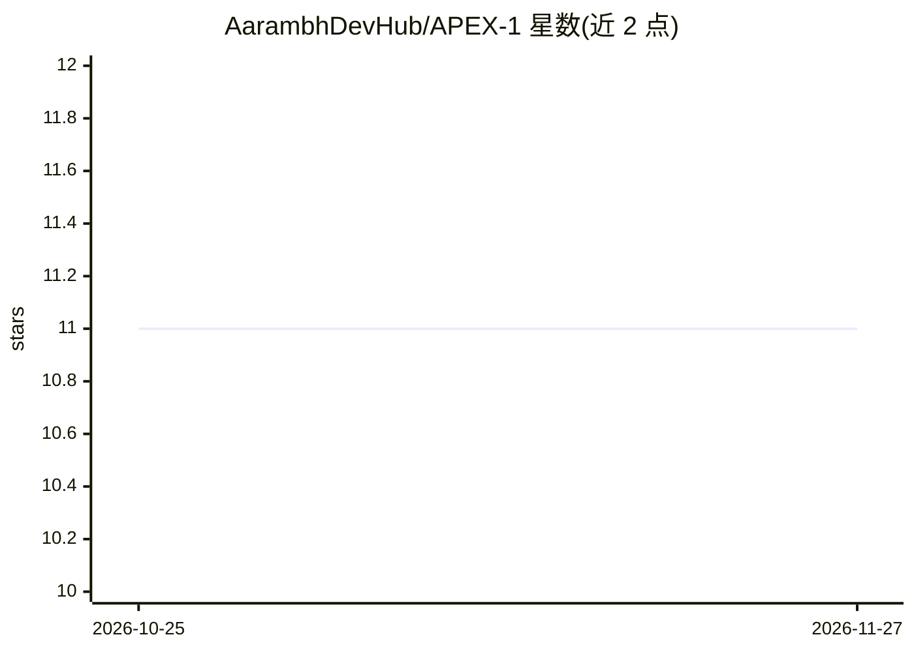

# AarambhDevHub/APEX-1

⭐ 11 · Python · Apache-2.0 · 推送 2026-06-07 · [GitHub](https://github.com/AarambhDevHub/APEX-1) · 个人维护 · 中文 README

**从零用 PyTorch 构建教育性 LLM 架构并配套完整课程**

APEX-1 是一个以教学为目的的 decoder-only transformer 实现项目，包含四个层面：架构代码（MLA 注意力、MoE 路由、GQA、滑动窗口注意力、多 token 预测、GRPO 对齐、Constitutional AI）、37 课完整课程与 24 个 bug 修复工程课、图像 token 接入的视觉-语言模型预览、以及 LoRA→QLoRA→DoRA→Adapter-DPO 的 PEFT 全生命周期代码（训练/保存/加载/合并/导出）。注意：项目不带预训练大 checkpoint，微调质量依赖自训练的基座。CPU 可运行示例。

## 筛选速览

| 维度 | 判定 | 备注 |
|---|---|---|
| AI 角色 | `ai-native` | 本体是模型或模型工具 |
| 许可风险 | `permissive` | Apache-2.0 |
| 部署形态 | `self-host` | docker 或自建部署 |
| 模型依赖 | — | README 未给出锁定关系 |
| 硬件要求 | `cpu-ok` | |
| 安装摩擦 | `low` | 无编译、无系统依赖或容器化 |
| 成熟度 | — | 结构信号不足 |

## 能力要点

- 从零实现 MLA、MoE、GQA、滑动窗口注意力等架构组件
- 完整 LoRA/QLoRA/DoRA/Adapter-DPO 微调代码与 CLI
- 37 课课程 + 24 个保留真实 bug 的工程教训
- 提供 course_ready_check 脚本与 pytest 测试套件

## 适用场景

- 想读懂现代 LLM 内部每一行代码的学习者
- 学习 LoRA/QLoRA/DoRA 微调的完整流程
- 在 CPU 上跑通小规模训练与生成演示

## 场景标签

`教程课程` `微调` `强化学习` · 领域:学习与行业

## 证据(README 行号)

> L33: **As an architecture**, it is a production-inspired decoder-only transformer learning project that synthesizes stro
> L35: **As a course**, it is a complete beginner-to-expert curriculum for understanding how modern large language models 

## 星数曲线

2026-10-25 11 → 2026-11-27 11（+0）

---
*卡片 v1 · prompt 1.4 · 生成 2026-11-19 · 置信度 mid · 依据 README sha `ed7709b4ab24` · [字段定义](../../DATASET.md)*
