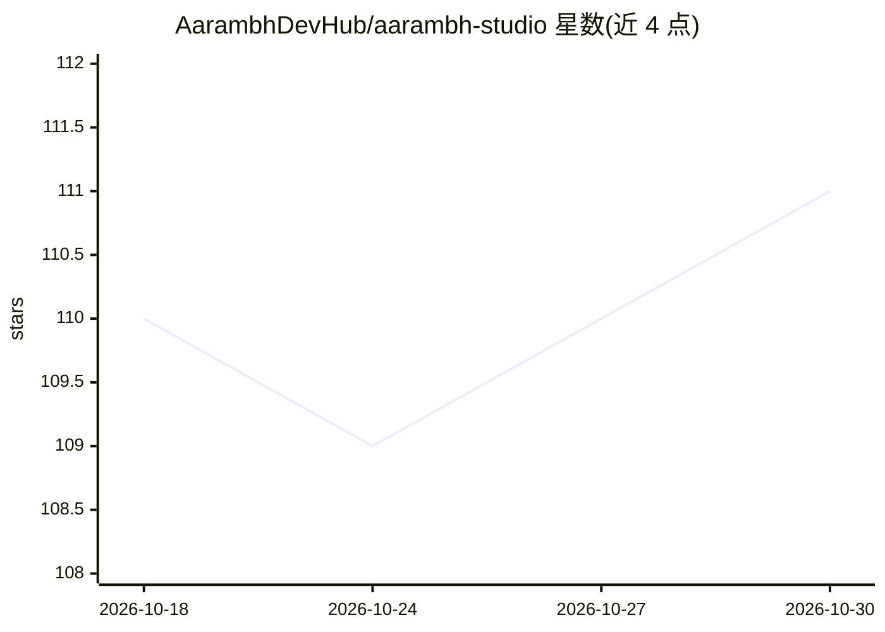

# AarambhDevHub/aarambh-studio

⭐ 111 · Rust · Apache-2.0 · 推送 2026-08-21 · [GitHub](https://github.com/AarambhDevHub/aarambh-studio) · 组织维护

**纯 Rust 从零实现的 decoder-only LLM 全流程系统（训练到服务）**

基于 Rust 与 Candle 从零构建的语言模型工程：覆盖 BPE 分词、模型构建、训练（含 QAT/多节点数据并行）、微调（LoRA/GRPO/DPO 等）、量化、GGUF 转换、多模态输入（图像/视频/文档/音频）、工具 Agent、RAG 与 OpenAI 兼容服务器，规模从 Tiny 25M 到 Large 1.3B。面向想自行训练模型的开发者：不发布 crate、不附带预训练权重或 GGUF 文件，用户须自训或提供兼容权重。v4.0.0 为最终计划版本。

## 筛选速览

| 维度 | 判定 | 备注 |
|---|---|---|
| AI 角色 | `ai-native` | 本体是模型或模型工具 |
| 许可风险 | `permissive` | Apache-2.0 |
| 部署形态 | `library` | 以包/库形式分发 |
| 模型依赖 | — | README 未给出锁定关系 |
| 硬件要求 | — | 无带数字的原话,不猜 |
| 安装摩擦 | `high` | 编译与系统依赖俱全 |
| 成熟度 | — | 结构信号不足 |

## 能力要点

- 训练/微调/量化/推理/服务全流程 CLI（20 个库 crate + 1 个 CLI 包）
- GQA、Gated DeltaNet、MLA、细粒度 MoE 等架构组件
- 多模态输入：图像/视频（H.264）/文档（像素级）/音频（WAV）
- RAG、多 Agent 编排、沙箱化工具执行与 OpenAI 兼容服务器

## 适用场景

- 从零训练自己的 decoder-only 语言模型（Tiny 到 1.3B）
- 在纯 Rust 技术栈内完成微调、量化与 GGUF 导出
- 本地运行带工具调用与 RAG 的推理服务器

## 场景标签

`模型训练` `微调` `模型量化` `多模态` · 领域:感知与多模态

## 证据(README 行号)

> L11: aarambh-studio is a decoder-only language model implementation built with Rust
> L12: and Candle. The repository covers the full engineering path: tokenization,
> L13: model construction, training, inference, quantization, adapter tuning,
> L14: alignment, evaluation, multimodal input, safety, and an OpenAI-compatible

## 星数曲线

2026-10-18 110 → 2026-10-30 111（+1）

---
*卡片 v1 · prompt 1.4 · 生成 2026-10-23 · 置信度 high · 依据 README sha `85222d39c27e` · [字段定义](../../DATASET.md)*
