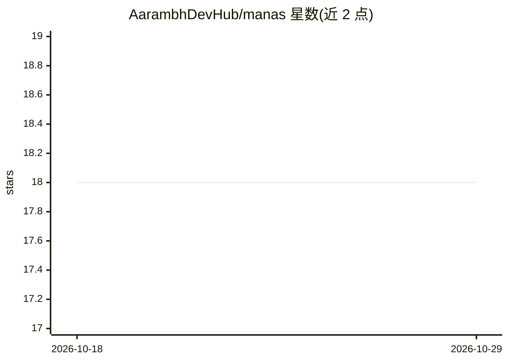

# AarambhDevHub/manas

⭐ 18 · Rust · Apache-2.0 · 推送 2026-07-10 · [GitHub](https://github.com/AarambhDevHub/manas) · [官网](https://github.com/AarambhDevHub/manas) · 个人维护

**Rust 从零实现的本地自生长神经网络记忆系统**

纯 Rust 从零编写（不依赖外部 ML 框架）的持续学习实验项目：以 CLI 形式通过 manas teach 逐条学习事实，知识直接存储于神经网络权重而非文本检索；网络按需生长新神经元，并通过 Open/Guarded/Frozen 三级保护机制防止灾难性遗忘。整个'大脑'持久化为单个 .manas 二进制文件，问答与本地语言生成均从权重直接读取。支持文件/文件夹摄取、新鲜度分级（Timeless/Slow/Fast/Realtime）与经 DuckDuckGo 的刷新代理。面向研究与实验用途，作者明确声明非生产级系统、非 LLM 替代品。

## 筛选速览

| 维度 | 判定 | 备注 |
|---|---|---|
| AI 角色 | `ai-native` | 本体是模型或模型工具 |
| 许可风险 | `permissive` | Apache-2.0 |
| 部署形态 | `None` |  |
| 模型依赖 | — | README 未给出锁定关系 |
| 硬件要求 | `cpu-ok` | |
| 安装摩擦 | `low` | 无编译、无系统依赖或容器化 |
| 成熟度 | `idea` | |

## 能力要点

- 知识存于神经网络权重，单 .manas 文件持久化，无文本检索
- Open/Guarded/Frozen 三级神经元保护实现抗遗忘
- 网络按需生长新神经元与新隐藏层，从空网络起步
- 无 GPU、无外部 ML 库，笔记本 CPU 运行

## 适用场景

- 在本地逐条教学事实并从权重直接问答
- 研究持续学习与抗灾难性遗忘机制
- 实验小型本地联想记忆系统（非 LLM 替代）

## 场景标签

`Agent 记忆` · 领域:Agent 开发

## 证据(README 行号)

> L5: **Manas is an experimental self-growing local AI brain written from scratch in Rust.**
> L44: ./manas teach "A cat is a small domesticated animal with fur and whiskers."
> L386: |A continual learning research project|A production AI system|

## 星数曲线

2026-10-18 18 → 2026-10-29 18（+0）

---
*卡片 v1 · prompt 1.4 · 生成 2026-10-29 · 置信度 high · 依据 README sha `16b405a68ab4` · [字段定义](../../DATASET.md)*
