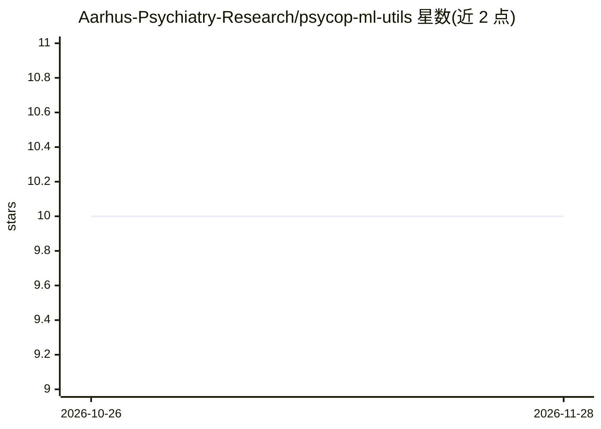

# Aarhus-Psychiatry-Research/psycop-ml-utils

⭐ 10 · Python · 推送 2026-11-23 · [GitHub](https://github.com/Aarhus-Psychiatry-Research/psycop-ml-utils) · [官网](https://aarhus-psychiatry-research.github.io/psycop-ml-utils/) · 组织维护

**PSYCOP 精神病学机器学习项目的工具函数库**

面向 PSYCOP 项目的机器学习工具库，README 提及特征生成能力并链接到相应模块。以 pip/poetry 方式安装，提供 API 参考文档与 FAQ。库服务于 PSYCOP 旗下的研究项目，例如精神科就诊患者的 2 型糖尿病预测研究；开发流程使用 black 代码风格与 GitHub Actions 上的 pytest 测试。具体模块清单与使用方式以链接文档为准，README 本身未展开。

## 筛选速览

| 维度 | 判定 | 备注 |
|---|---|---|
| AI 角色 | `ai-ecosystem` | LLM/agent 周边工具 |
| 许可风险 | `none` | — |
| 部署形态 | `library` | 以包/库形式分发 |
| 模型依赖 | — | README 未给出锁定关系 |
| 硬件要求 | — | 无带数字的原话,不猜 |
| 安装摩擦 | `low` | 无编译、无系统依赖或容器化 |
| 成熟度 | — | 结构信号不足 |

## 能力要点

- 提供机器学习工具函数（含特征生成指引）
- 支持 pip 与 poetry 两种安装方式
- 提供 API 参考文档与 FAQ
- 配套 GitHub Issue/Discussions 支持渠道

## 适用场景

- 在 PSYCOP 类临床精神病学预测研究中复用工具函数
- 生成机器学习特征
- 作为科研团队内部机器学习代码的基础库

## 场景标签

`科研工具` · 领域:学习与行业

## 证据(README 行号)

> L1: # Misc. PSYCOP utilities
> L20: pip install psycop_ml_utils
> L30: |**[Type 2 Diabetes]**||Prediction of type 2 diabetes among patients with visits to psychiatric hospital department

## 星数曲线

2026-10-26 10 → 2026-11-28 10（+0）

---
*卡片 v1 · prompt 1.4 · 生成 2026-11-20 · 置信度 mid · 依据 README sha `40394ddfadf3` · [字段定义](../../DATASET.md)*
