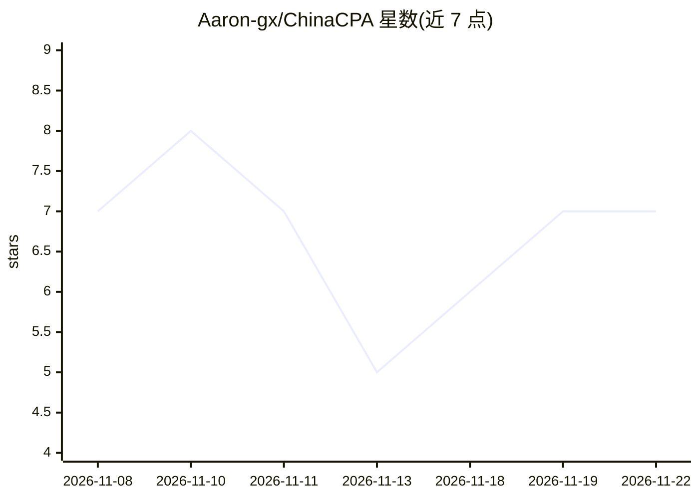

# Aaron-gx/ChinaCPA

⭐ 7 · Go · 推送 2026-11-18 · [GitHub](https://github.com/Aaron-gx/ChinaCPA) · 个人维护 · 中文 README

**纳管六大国产 AI 平台账号的反代网关：签到攒积分并统一 OpenAI 接口调用**

以单二进制 Go 程序运行的反代网关，将 WorkBuddy、Qwen、Trae、Qoder、千问办公、豆包六个平台的账号凭证通过 OAuth/扫码/PAT/Cookie 方式纳管，提供每日自动签到、额度刷新与用量费用统计。对外暴露 OpenAI/Responses/Anthropic 三种协议端点，支持面板自定义发布模型、多渠道路由、失败转移与多账号轮询。仅限个人学习研究用途；上游平台接口逆向实现，风控收紧时通道可能失效。

## 筛选速览

| 维度 | 判定 | 备注 |
|---|---|---|
| AI 角色 | `ai-ecosystem` | LLM/agent 周边工具 |
| 许可风险 | `none` | — |
| 部署形态 | `desktop` | 安装包/桌面程序 |
| 模型依赖 | — | README 未给出锁定关系 |
| 硬件要求 | — | 无带数字的原话,不猜 |
| 安装摩擦 | `medium` | 含编译或系统依赖之一 |
| 成熟度 | — | 结构信号不足 |

## 能力要点

- OAuth/扫码/PAT/refreshToken/Cookie 多方式纳管六大国产 AI 平台
- 自动签到、每 10 分钟额度刷新与费用估算仪表板
- OpenAI/Responses/Anthropic 三协议兼容网关，含 SSE 流式
- 发布模型多渠道路由 + 失败转移 + 多账号轮询，纯 Go 标准库零依赖

## 适用场景

- 把各平台免费额度聚合成一个 OpenAI 兼容接口供本地工具调用
- 给 Codex CLI / Claude Code 配置国产上游模型
- 集中查看多账号积分、额度与每日 token 消耗

## 场景标签

`模型网关` · 领域:Agent 开发

## 证据(README 行号)

> L36: - **OpenAI 兼容网关**：`/v1/models` + `/v1/chat/completions`（SSE 流式），多账号自动轮询 + 失败转移 + 限流冷却；上游凭证失效自动标记「需重新登录」并停止调度，重新导入即恢
> L39: - **单二进制**：纯 Go 标准库，零第三方依赖，下载即用

## 星数曲线

2026-11-08 7 → 2026-11-22 7（+0）

---
*卡片 v1 · prompt 1.4 · 生成 2026-11-20 · 置信度 high · 依据 README sha `942294befdaa` · [字段定义](../../DATASET.md)*
