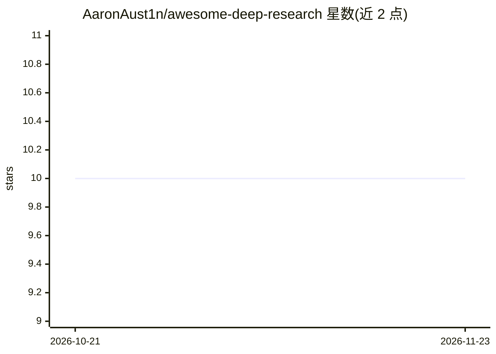

# AaronAust1n/awesome-deep-research

⭐ 10 · MIT · 推送 2026-09-30 · [GitHub](https://github.com/AaronAust1n/awesome-deep-research) · 个人维护 · 中文 README

**深度研究开源项目清单：为开发者策展 agent/模型/基准项目**

一份按类别组织的开源深度研究项目聚合清单，收录 Frameworks & Agents、Agent Skills、Benchmarks & Evaluation、Search & Applications 四类项目，条目含星数、语言、分类、状态、标签与特性说明，并对部分项目提供逐项详情（特性列表、开源日期、许可证）。服务对象为查找与筛选深度研究相关开源工具的开发者与研究者。维护中文与英文双版本，含贡献者与状态徽章。README 未提供各项目的安装方式。

## 筛选速览

| 维度 | 判定 | 备注 |
|---|---|---|
| AI 角色 | `ai-knowledge` | 知识聚合/清单类 |
| 许可风险 | `permissive` | MIT |
| 部署形态 | `self-host` | docker 或自建部署 |
| 模型依赖 | — | README 未给出锁定关系 |
| 硬件要求 | — | 无带数字的原话,不猜 |
| 安装摩擦 | `low` | 无编译、无系统依赖或容器化 |
| 成熟度 | — | 结构信号不足 |

## 能力要点

- 按 Frameworks & Agents / Agent Skills / Benchmarks / Search 四类组织条目
- 每条含星数、语言、状态、标签与特性说明
- 对头部项目提供逐项特性详情与开源日期
- 提供中英文双版本

## 适用场景

- 选型时浏览深度研究 agent 与模型的开源实现
- 查找深度研究相关的评测基准数据集
- 寻找可自托管的 AI 搜索引擎项目

## 场景标签

`精选清单` · 领域:学习与行业

## 证据(README 行号)

> L1: # Awesome Deep Research
> L14: ## Frameworks & Agents
> L46: ## Agent Skills

## 星数曲线

2026-10-21 10 → 2026-11-23 10（+0）

---
*卡片 v1 · prompt 1.4 · 生成 2026-11-20 · 置信度 mid · 依据 README sha `7ff748e3e414` · [字段定义](../../DATASET.md)*
