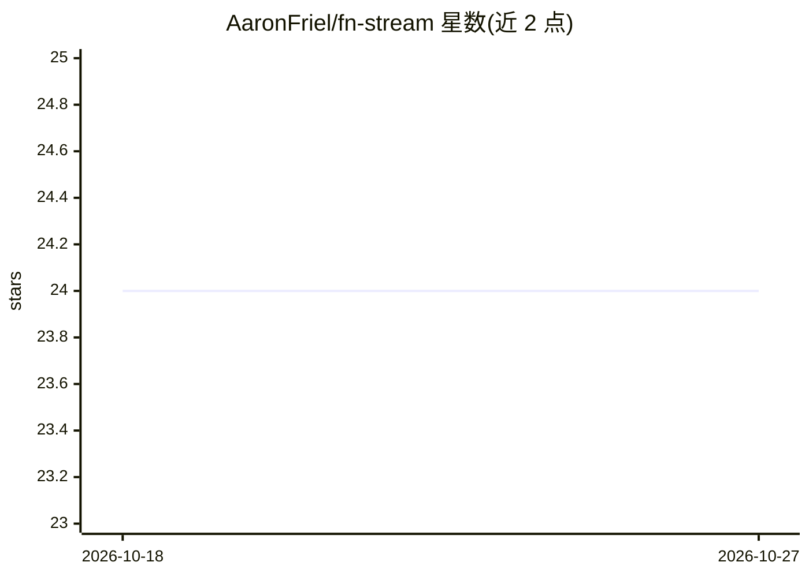

# AaronFriel/fn-stream

⭐ 24 · TypeScript · 推送 2026-03-14 · [GitHub](https://github.com/AaronFriel/fn-stream) · 个人维护

**TypeScript 库：LLM 结构化输出与流式响应同时处理**

面向 JavaScript/TypeScript 开发者的库，解决生成式 AI 工具中流式响应与结构化数据（tools）二选一的问题。核心机制包括：在线 StreamingParser 逐 token/字符解析 LLM 的 JSON 输出、ParseEvents 类型描述部分解析对象、基于 ts-pattern 的事件模式匹配、以及面向 openai 包的工具定义适配器（借助 json-schema-to-ts 减少样板代码）。用 TypeScript 编写但不强制要求使用。提供 CLI 示例与客户端/服务器风格示例，需设置 OPENAI_API_KEY 运行。

## 筛选速览

| 维度 | 判定 | 备注 |
|---|---|---|
| AI 角色 | `ai-ecosystem` | LLM/agent 周边工具 |
| 许可风险 | `none` | — |
| 部署形态 | `library` | 以包/库形式分发 |
| 模型依赖 | — | README 未给出锁定关系 |
| 硬件要求 | — | 无带数字的原话,不猜 |
| 安装摩擦 | `low` | 无编译、无系统依赖或容器化 |
| 成熟度 | — | 结构信号不足 |

## 能力要点

- StreamingParser 逐 token/字符在线解析 LLM 的 JSON 输出
- ParseEvents 类型化部分解析对象，配合 ts-pattern 模式匹配
- OpenAI 工具定义适配器，用 json-schema-to-ts 减少样板
- 用 TypeScript 编写但不强制要求

## 适用场景

- 构建需要边生成边处理结构化字段的 LLM 交互应用
- 从模型多模态输出中按需提取并流式渲染指定字段（如仅代码）
- 客户端/服务器分离状态下同步 LLM 结构化输出

## 场景标签

 · 领域:LLM 应用开发库

## 证据(README 行号)

> L3: `fn-stream` is a library that makes it possible to combine generative AI (large language models) with tools in inter
> L13: * The online `StreamingParser` that can parse JSON output from a large language model token-by-token or character-b
> L16: * Adapters for defining tools for large language model APIs, such as the `openai` package, making it easy to define

## 星数曲线

2026-10-18 24 → 2026-10-27 24（+0）

---
*卡片 v1 · prompt 1.4 · 生成 2026-10-27 · 置信度 high · 依据 README sha `207426eb0a3c` · [字段定义](../../DATASET.md)*
