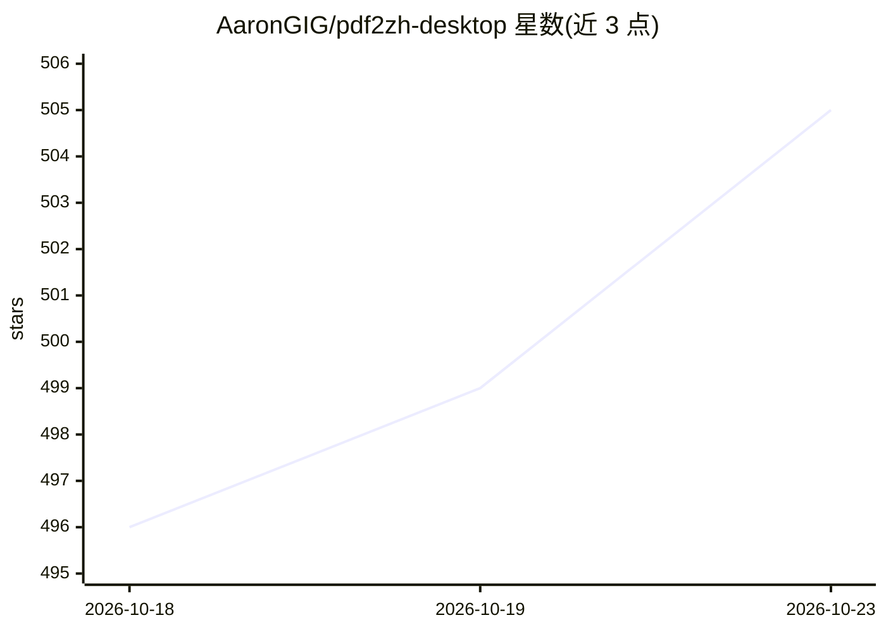

# AaronGIG/pdf2zh-desktop

⭐ 505 · Python · 推送 2026-10-20 · [GitHub](https://github.com/AaronGIG/pdf2zh-desktop) · [官网](https://aarongig.github.io/pdf2zh-desktop/) · 个人维护 · 中文 README

**开箱即用的 PDF 学术翻译桌面应用，保留公式排版并联动 Zotero**

基于 PDFMathTranslate（EMNLP 2025）的 Windows/macOS 桌面应用：拖入 PDF 后调用 20+ 翻译服务（Google/Bing 免费，DeepSeek、OpenAI、Gemini、Ollama 等 API Key 或本地部署）产出纯译文、双语对照与左右并排三种 PDF。保留公式与排版，内置 RapidOCR 处理扫描件、独立表格管线、术语库与自动术语提取，支持分块翻译、断点续传与批量拖放；译文可自动回写为 Zotero 附件。程序离线独立打包，无需安装 Python；在线翻译服务需联网。

## 筛选速览

| 维度 | 判定 | 备注 |
|---|---|---|
| AI 角色 | `ai-native` | 本体是模型或模型工具 |
| 许可风险 | `none` | — |
| 部署形态 | `desktop` | 安装包/桌面程序 |
| 模型依赖 | local-ok | 支持本地模型 |
| 硬件要求 | — | 无带数字的原话,不猜 |
| 安装摩擦 | `low` | 无编译、无系统依赖或容器化 |
| 成熟度 | — | 结构信号不足 |

## 能力要点

- 20+ 翻译服务预设（含 OpenAI 兼容格式、Ollama/Xinference/Argos 本地部署）
- 公式/图表/排版保留，输出 mono/dual/side_by_side 三种 PDF
- 内置 RapidOCR、独立表格翻译管线与术语库
- Zotero 深度联动：译文自动关联附件、右键直接翻译

## 适用场景

- 翻译外文学术论文并保留公式排版
- 批量翻译专利、检测报告等表格密集 PDF
- 在 Zotero 文献管理流程中一键翻译并归档译文
- 离线环境下用 Ollama/Argos Translate 翻译 PDF

## 场景标签

`科研工具` · 领域:学习与行业

## 证据(README 行号)

> L79: - 🧩 **20+ 预设模型**：DeepSeek V3/R1、GPT-4o、GLM-4、Gemini、Mistral、Ollama 等，下拉框直接选
> L156: |🏠 本地部署|Ollama、Xinference、Argos Translate（完全离线）|
> L39: > 基于 PDFMathTranslate（EMNLP 2025）打造，在原项目基础上大幅增强桌面体验。

## 星数曲线

2026-10-18 496 → 2026-10-23 505（+9）

---
*卡片 v1 · prompt 1.4 · 生成 2026-10-22 · 置信度 high · 依据 README sha `5532d7508f35` · [字段定义](../../DATASET.md)*
