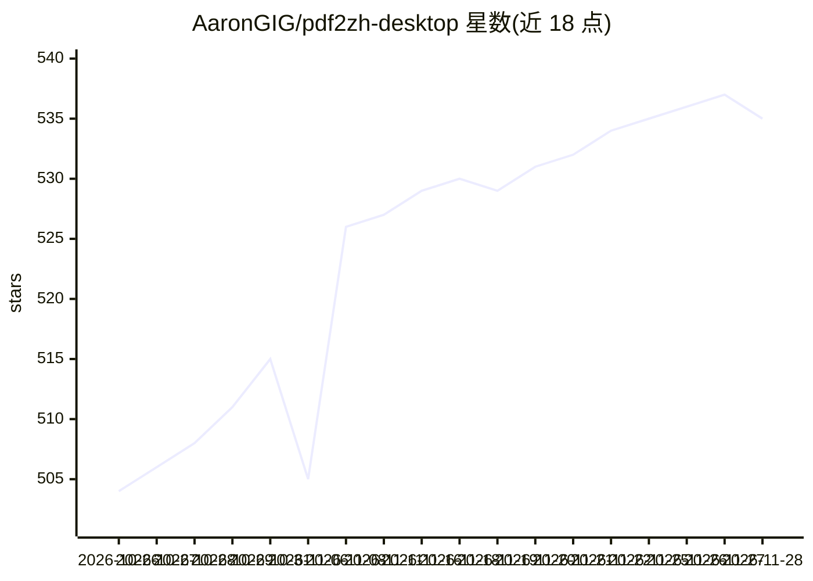

# AaronGIG/pdf2zh-desktop

⭐ 535 · Python · 推送 2026-11-26 · [GitHub](https://github.com/AaronGIG/pdf2zh-desktop) · [官网](https://aarongig.github.io/pdf2zh-desktop/) · 个人维护 · 中文 README

**PDF 学术论文翻译桌面应用，保留公式排版并联动 Zotero**

基于 PDFMathTranslate（EMNLP 2025）的桌面封装，用户拖入 PDF 即可翻译，输出单语、双语对照、左右并排三种格式，保留公式、图表与排版。内置 Python 3.12 运行时与依赖，Windows/macOS 解压即用，无需安装 Python。支持 35 种语言、20+ 翻译服务（免费/Key/国内/本地部署），提供 OCR 识别扫描件、分块翻译、术语库、批量翻译与 Zotero 附件回写；阅读页含 AI 助手解读论文。使用在线服务需联网。

## 筛选速览

| 维度 | 判定 | 备注 |
|---|---|---|
| AI 角色 | `ai-native` | 本体是模型或模型工具 |
| 许可风险 | `none` | — |
| 部署形态 | `desktop` | 安装包/桌面程序 |
| 模型依赖 | local-ok | 支持本地模型 |
| 硬件要求 | — | 无带数字的原话,不猜 |
| 安装摩擦 | `low` | 无编译、无系统依赖或容器化 |
| 成熟度 | — | 结构信号不足 |

## 能力要点

- 解压即用的独立打包：Python 3.12 运行时与依赖内置
- 20+ 翻译服务含免费、API Key、国内与本地部署（Ollama/Xinference/Argos 离线）
- OCR 识别纯图片扫描件、表格独立翻译管线、5 学科术语库
- Zotero 深度联动：拖入翻译后译文自动回写为附件

## 适用场景

- 翻译英文论文并保留公式与排版供对照阅读
- 把 Zotero 里的文献批量翻译并自动挂回附件
- 离线翻译扫描版 PDF（Argos Translate/Ollama 本地部署）
- 为专利、检测报告等表格密集文件做批量翻译

## 场景标签

`科研工具` `OCR` `文档解析` · 领域:知识与检索

## 证据(README 行号)

> L39: > 基于 PDFMathTranslate（EMNLP 2025）打造，在原项目基础上大幅增强桌面体验。
> L79: - 🧩 **20+ 预设模型**：DeepSeek V3/R1、GPT-4o、GLM-4、Gemini、Mistral、Ollama 等，下拉框直接选

## 星数曲线

2026-10-26 504 → 2026-11-28 535（+31）

---
*卡片 v1 · prompt 1.4 · 生成 2026-11-27 · 置信度 high · 依据 README sha `5697026831f1` · [字段定义](../../DATASET.md)*
