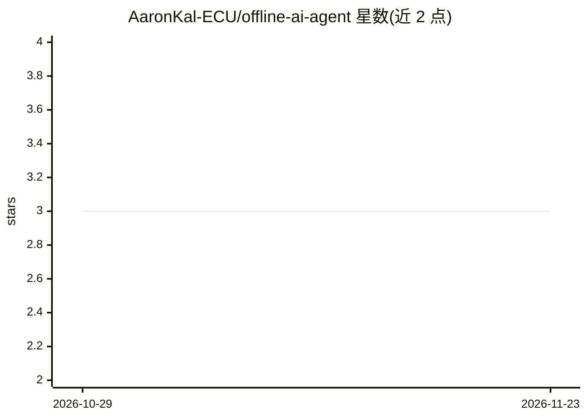

# AaronKal-ECU/offline-ai-agent

⭐ 3 · JavaScript · MIT · 推送 2026-10-27 · [GitHub](https://github.com/AaronKal-ECU/offline-ai-agent) · 个人维护

**在自有 PC 上离线运行 AI 的入门指南与定制工具展示**

一份本地 AI 部署指南加插件展示：作者用 RTX 3060（12 GB VRAM）Windows PC，通过 Ollama 运行量化为 Q6_K 的 Qwen3 8B，接入 DeepSeek Harness (DSH) 作为 agent 层，在浏览器中获得对话界面、会话、工具与插件系统。内容覆盖硬件选型表、模型量化与 no-think 变体说明、双实例 profile 隔离、confidential mode（会话请求在 harness 层强制重写到本地模型）、以及多遍流水线的会议记录脱敏插件。插件代码随仓库附带，作者注明其为实习 demo、未部署。

## 筛选速览

| 维度 | 判定 | 备注 |
|---|---|---|
| AI 角色 | `ai-knowledge` | 知识聚合/清单类 |
| 许可风险 | `permissive` | MIT |
| 部署形态 | `None` |  |
| 模型依赖 | local-ok | 支持本地模型 |
| 硬件要求 | `gpu-8g` | |
| 安装摩擦 | `low` | 无编译、无系统依赖或容器化 |
| 成熟度 | — | 结构信号不足 |

## 能力要点

- 三层架构文档化：Qwen3 8B (Q6_K) + Ollama 运行时 + DSH agent 层
- confidential mode 在 harness 层将请求强制重写为本地模型，禁用工具
- 六插件定制审计助手，含多遍转写脱敏流水线（改写/长度守卫/姓名扫描/正则兜底）
- 本地与云模型共存的混合路由展示

## 适用场景

- 在自有电脑上从零搭建可离线使用的 AI 助手
- 处理客户敏感数据时切换到仅本地模型会话
- 给会议记录做本地脱敏后再交给云端模型处理
- 参考 DSH 插件代码学习为 AI 助手编写自定义工具

## 场景标签

`AI 助手` `教程课程` · 领域:对话与助手

## 证据(README 行号)

> L10: 1. **A getting-started guide to local AI:** what you need, and how to get a model running on your own PC with no cl
> L11: 2. **A brief overview of AI harnesses and building custom tools for AI to use**, using DeepSeek Harness to build a 
> L50: 1. **The model I used:** Qwen3 8B, an open-weights model, quantised to Q6_K so it fits in 12 GB of VRAM. It's a fil

## 星数曲线

2026-10-29 3 → 2026-11-23 3（+0）

---
*卡片 v1 · prompt 1.4 · 生成 2026-11-22 · 置信度 mid · 依据 README sha `0cdcbdb07e70` · [字段定义](../../DATASET.md)*
