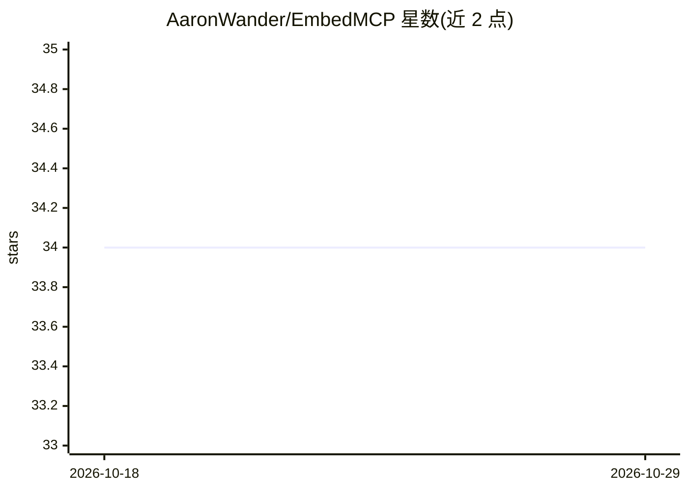

# AaronWander/EmbedMCP

⭐ 34 · C · MIT · 推送 2026-02-10 · [GitHub](https://github.com/AaronWander/EmbedMCP) · 个人维护 · 中文 README

**轻量 C 库：把嵌入式 C 函数封装成 MCP 服务器供 AI 调用**

面向嵌入式开发者的自包含 C 库，通过宏或 schema 两种注册方式把既有 C 函数暴露为 MCP 工具，供 Claude Desktop 等 MCP 客户端调用。提供 Streamable HTTP 与 STDIO 两种传输模式，支持 HTTP 会话管理与协议版本协商；通过 Universal HAL 运行于 15+ 平台（FreeRTOS/Zephyr/STM32/ESP32/树莓派等），最低要求 C99 编译器、64KB RAM、100KB flash，无外部依赖。内存管理（参数、JSON、数组）由库自动处理，字符串返回值需用户 malloc。复制文件夹即可集成，make 构建。

## 筛选速览

| 维度 | 判定 | 备注 |
|---|---|---|
| AI 角色 | `ai-ecosystem` | LLM/agent 周边工具 |
| 许可风险 | `permissive` | MIT |
| 部署形态 | `None` |  |
| 模型依赖 | — | README 未给出锁定关系 |
| 硬件要求 | — | 无带数字的原话,不猜 |
| 安装摩擦 | `low` | 无编译、无系统依赖或容器化 |
| 成熟度 | — | 结构信号不足 |

## 能力要点

- 宏注册与 schema 注册两种方式将 C 函数暴露为 MCP 工具
- Streamable HTTP 与 STDIO 两种传输模式，支持多客户端并发与会话管理
- 15+ 嵌入式平台支持，最低 64KB RAM / 100KB flash，零外部依赖
- 参数/JSON/数组内存由库自动清理

## 适用场景

- 把传感器驱动或设备控制 C 函数暴露给 AI 模型调用
- 让 Claude Desktop 等 MCP 客户端直接操作嵌入式设备
- 在 MCU/RTOS 上部署轻量 MCP 服务端

## 场景标签

`Agent 框架` · 领域:Agent 开发

## 证据(README 行号)

> L3: A lightweight C library for creating MCP (Model Context Protocol) servers that transforms your existing C functions 
> L141: - Claude Desktop integration

## 星数曲线

2026-10-18 34 → 2026-10-29 34（+0）

---
*卡片 v1 · prompt 1.4 · 生成 2026-10-25 · 置信度 high · 依据 README sha `aa11ad034b09` · [字段定义](../../DATASET.md)*
