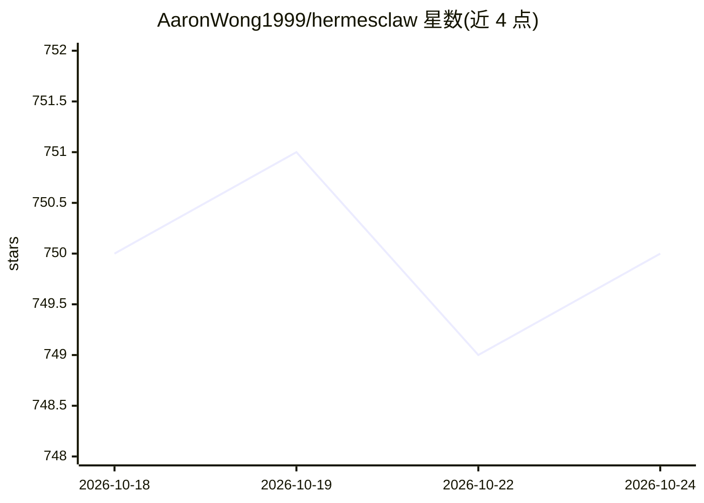

# AaronWong1999/hermesclaw

⭐ 750 · Python · MIT · 推送 2026-10-20 · [GitHub](https://github.com/AaronWong1999/hermesclaw) · 个人维护 · 中文 README

**让三个 AI Agent 共用同一微信账号的转发代理**

约 500 行的 Python 轻量代理：作为唯一的 iLink 轮询者，运行两个本地代理服务器（分别对接 Hermes Agent 与 OpenClaw 的微信 Gateway）和一个 ACP 子进程桥（对接 OpenCode），使三者可同时绑定同一微信账号并通过 /hermes、/openclaw、/opencode、/both、/three 命令切换或并行。它只排队并转发原始 iLink 协议消息，不处理媒体解密、不调 Agent API。安装前需至少装好 OpenClaw+clawbot 或 Hermes Gateway 之一；提供 curl 一键安装脚本与 systemd/launchd 后台服务，支持 Linux 与 macOS。

## 筛选速览

| 维度 | 判定 | 备注 |
|---|---|---|
| AI 角色 | `ai-ecosystem` | LLM/agent 周边工具 |
| 许可风险 | `permissive` | MIT |
| 部署形态 | `library` | 以包/库形式分发 |
| 模型依赖 | — | README 未给出锁定关系 |
| 硬件要求 | — | 无带数字的原话,不猜 |
| 安装摩擦 | `low` | 无编译、无系统依赖或容器化 |
| 成熟度 | — | 结构信号不足 |

## 能力要点

- 作为唯一 iLink 轮询者运行双本地代理 + ACP 桥，解决 Gateway 独占连接的 403 冲突
- /hermes /openclaw /opencode /both /three 五种路由命令，多 Agent 回复带来源前缀
- 仅转发原始 iLink 协议消息，媒体解密由各 Gateway 原生处理
- 一条 curl 命令安装，自动检测 Gateway、提取 token、配置 systemd/launchd 服务

## 适用场景

- 在同一微信账号上同时使用 Hermes Agent 和 OpenClaw 而不冲突
- 通过微信语音消息调用 OpenCode 进行 Vibe Coding
- 多 Agent 并行回答同一问题并对比结果

## 场景标签

 · 领域:AI Agent 基础设施/聊天机器人

## 证据(README 行号)

> L20: Both Hermes Agent and OpenClaw now support WeChat natively — **but you can't run both on the same account.** Each g
> L22: HermesClaw solves this by becoming the **sole iLink poller**, then running two local proxy servers (for Hermes and 
> L63: HermesClaw is a thin Python proxy (~500 lines). It does **not** process media, call agent APIs, or touch agent memo

## 星数曲线

2026-10-18 750 → 2026-10-24 750（+0）

---
*卡片 v1 · prompt 1.4 · 生成 2026-10-21 · 置信度 mid · 依据 README sha `96b240ed60bf` · [字段定义](../../DATASET.md)*
