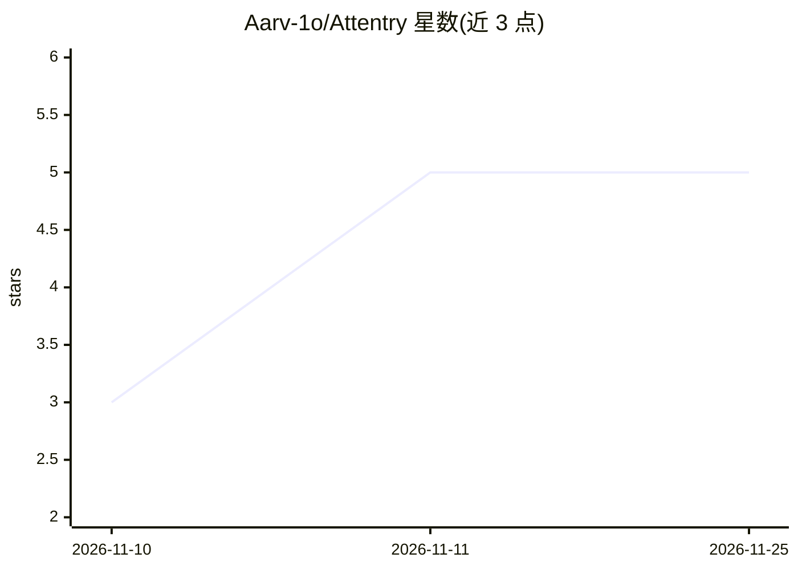

# Aarv-1o/Attentry

⭐ 5 · TypeScript · MIT · 推送 2026-11-23 · [GitHub](https://github.com/Aarv-1o/Attentry) · [官网](https://attentry.js.org) · 个人维护

**本地静态分析器：审查 Claude Code/Codex 的每次代码编辑**

一个 VS Code 扩展加命令行工具，在 AI 编码代理（Claude Code、Codex）编辑代码时进行本地静态检查：安全漏洞、崩溃风险、重复与死代码、数据库与前后端问题。非 LLM 包装，使用自有规则引擎，无需 API key，代码不离开本机。通过 hooks 与 MCP 工具（find_existing/check/explain/check_plan）向代理反馈，支持 suggest 与 block 模式，任务结束生成变更卡片。支持 JS/TS/Python/Astro。

## 筛选速览

| 维度 | 判定 | 备注 |
|---|---|---|
| AI 角色 | `ai-ecosystem` | LLM/agent 周边工具 |
| 许可风险 | `permissive` | MIT |
| 部署形态 | `library` | 以包/库形式分发 |
| 模型依赖 | locked-api |  |
| 硬件要求 | — | 无带数字的原话,不猜 |
| 安装摩擦 | `low` | 无编译、无系统依赖或容器化 |
| 成熟度 | — | 结构信号不足 |

## 能力要点

- 自研静态分析器，非 AI 模型包装，本地运行无 token 成本
- 通过 hooks/MCP 在代理编辑后即时反馈，代理可立即修复
- 安全检查覆盖注入、SSRF、XSS、JWT、权限缺失等项
- 支持 VS Code/Cursor/Windsurf/Antigravity 及 lsp 接入

## 适用场景

- 让 Claude Code 写代码时自动拦截新增安全与崩溃问题
- 对 agent 生成的代码做本地无 AI 的安全审查
- 检测仓库中重复函数与无用代码

## 场景标签

 · 领域:开发工具/代码质量与安全

## 证据(README 行号)

> L18: Attentry reads that code for you, while the agent is still working. It isn't a wrapper around
> L110: All four only read. They're built on the official MCP SDK and validate every call, so a bad call

## 星数曲线

2026-11-10 3 → 2026-11-25 5（+2）

---
*卡片 v1 · prompt 1.4 · 生成 2026-11-21 · 置信度 high · 依据 README sha `a4fc48cbbc7d` · [字段定义](../../DATASET.md)*
