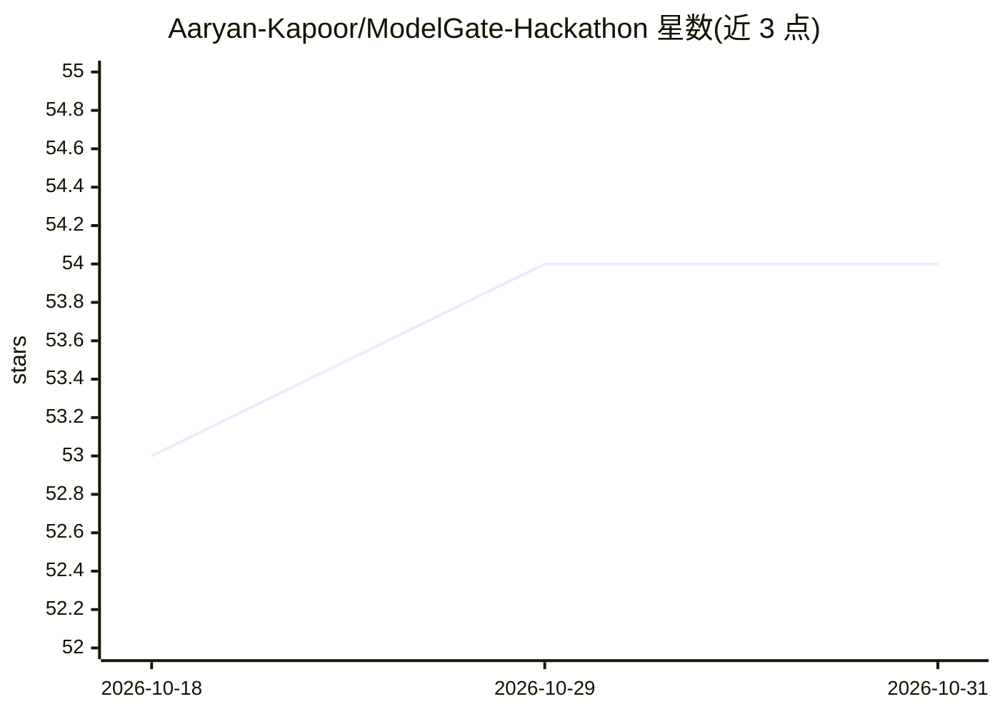

# Aaryan-Kapoor/ModelGate-Hackathon

⭐ 54 · TypeScript · MIT · 推送 2026-03-22 · [GitHub](https://github.com/Aaryan-Kapoor/ModelGate-Hackathon) · 组织维护

**按合同约束自动路由 LLM 请求的控制平面，降成本**

面向企业 LLM 使用的 AI 控制平面：上传客户合同（SLA、隐私、合规条款），由 LLM 抽取为结构化客户画像（区域限制、允许供应商、延迟目标、成本敏感度），再生成 OpenAI 兼容代理端点；每个请求由经 GRPO 微调的 1.5B 分类器（GGUF Q8_0，约 62ms）分级，路由到满足合同约束的最低成本模型，底层经 OpenRouter 调用多家供应商。后端 FastAPI + SQLite，前端 Next.js 仪表盘展示路由决策与成本。需 NVIDIA GPU 与 OpenRouter API key，属黑客松获奖项目。

## 筛选速览

| 维度 | 判定 | 备注 |
|---|---|---|
| AI 角色 | `ai-ecosystem` | LLM/agent 周边工具 |
| 许可风险 | `permissive` | MIT |
| 部署形态 | `None` |  |
| 模型依赖 | local-ok | 支持本地模型 |
| 硬件要求 | — | 无带数字的原话,不猜 |
| 安装摩擦 | `medium` | 含编译或系统依赖之一 |
| 成熟度 | — | 结构信号不足 |

## 能力要点

- 合同→LLM 抽取结构化客户画像→OpenAI 兼容端点自动路由
- GRPO 微调 1.5B 路由分类器，GGUF Q8_0 量化至 1.6GB、62ms 分级
- MMLU 路由基准：成本 -59%，整体准确率 85%
- 模型注册表支持浏览 OpenRouter 目录并一键开关模型

## 适用场景

- 把 base_url 改一行即可接入代理，自动压缩模型调用成本
- 按客户合同的隐私/区域/供应商限制逐请求强制合规
- 通过仪表盘监控路由分布、成本节省与请求轨迹

## 场景标签

`模型网关` · 领域:Agent 开发

## 证据(README 行号)

> L9: ModelGate is a contract-aware AI control plane that ingests customer contracts, extracts SLA/privacy/routing constra
> L94: [Next.js Dashboard :3000] → [FastAPI :8000] → [OpenRouter / Direct APIs]
> L104: |Classification|ModelGate-Router (fine-tuned), GGUF Q8_0, llama-cpp-python|

## 星数曲线

2026-10-18 53 → 2026-10-31 54（+1）

---
*卡片 v1 · prompt 1.4 · 生成 2026-10-24 · 置信度 high · 依据 README sha `dffe1db3afeb` · [字段定义](../../DATASET.md)*
