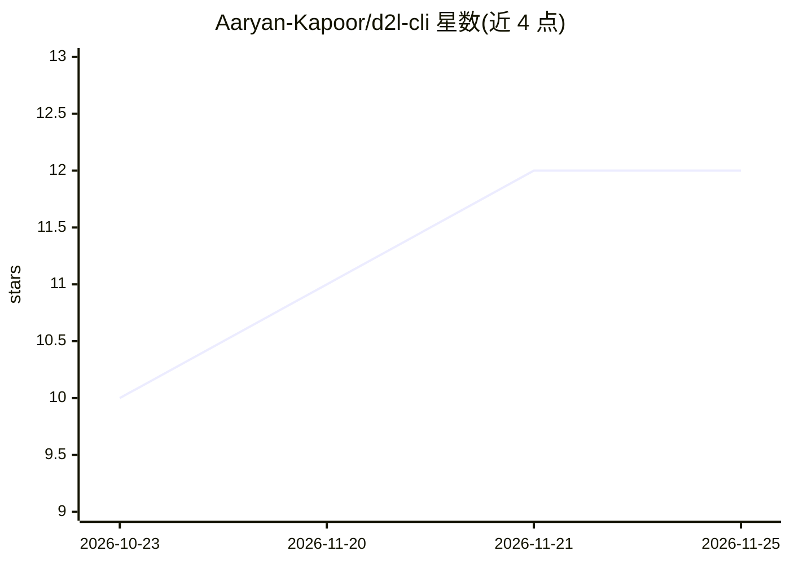

# Aaryan-Kapoor/d2l-cli

⭐ 12 · Python · MIT · 推送 2026-09-24 · [GitHub](https://github.com/Aaryan-Kapoor/d2l-cli) · [官网](https://pypi.org/project/d2l-cli/) · 个人维护

**给 AI agent 提供只读访问 D2L Brightspace 课程数据的 CLI**

一个 Python CLI，让可运行命令的 AI agent（Claude Code、Cursor、Copilot、Gemini CLI 等）以只读方式访问 D2L Brightspace 课程：成绩、截止日期、作业、测验、教学大纲、公告、讲义文件。所有 API 调用均为 GET，物理上无法提交或修改任何内容；认证复用学校 SSO 浏览器登录，CLI 仅捕获短时 API token 并自动刷新。提供 pipx/ pip 安装、`d2l skill install` 便携技能包、`--json/--md` 机器可读输出与 `d2l doctor` 状态自检，支持任意 Brightspace 学校（--host）及两个预置学校。

## 筛选速览

| 维度 | 判定 | 备注 |
|---|---|---|
| AI 角色 | `ai-ecosystem` | LLM/agent 周边工具 |
| 许可风险 | `permissive` | MIT |
| 部署形态 | `library` | 以包/库形式分发 |
| 模型依赖 | — | README 未给出锁定关系 |
| 硬件要求 | — | 无带数字的原话,不猜 |
| 安装摩擦 | `low` | 无编译、无系统依赖或容器化 |
| 成熟度 | — | 结构信号不足 |

## 能力要点

- 所有 API 调用均为 GET，强制只读，无法提交或修改数据
- d2l skill install 可将便携技能包（SKILL.md）装入任意技能系统
- 复用学校 SSO 浏览器登录，token 每小时自动刷新，无需反复登录
- 支持 --json/--md 机器可读输出与无头服务器场景

## 适用场景

- 让 agent 汇总各课程成绩并分析丢分点
- 按教学大纲权重生成未来 7 天学习计划
- 下载讲义并让 agent 逐题测验复习
- 定时任务输出 24 小时内公告与截止变化简报

## 场景标签

 · 领域:教育/开发工具

## 证据(README 行号)

> L9: **d2l-cli** gives any AI agent — Claude Code, OpenClaw, Cursor, Copilot, Gemini CLI, anything that can run a command
> L91: 1. **Your agent runs `d2l`** — a small Python CLI that talks to Brightspace's own student API. Every call is a GET;
> L133: - `AGENTS.md` at the repo root is the standing instruction file picked up by Claude Code, Cursor, Copilot, Codex, 

## 星数曲线

2026-10-23 10 → 2026-11-25 12（+2）

---
*卡片 v1 · prompt 1.4 · 生成 2026-11-20 · 置信度 high · 依据 README sha `8b18f5ff0cb6` · [字段定义](../../DATASET.md)*
