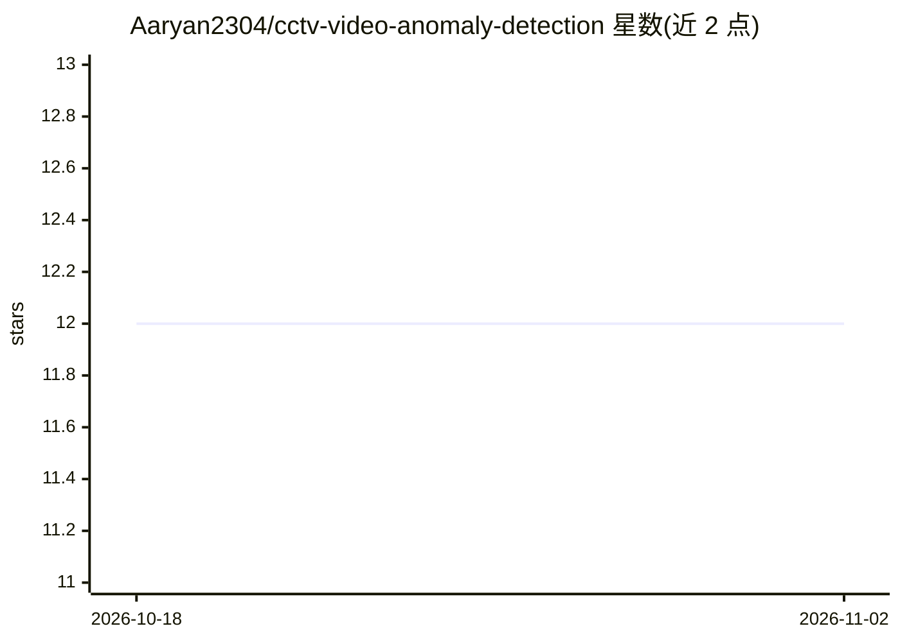

# Aaryan2304/cctv-video-anomaly-detection

⭐ 12 · Python · Apache-2.0 · 推送 2026-01-14 · [GitHub](https://github.com/Aaryan2304/cctv-video-anomaly-detection) · 个人维护

**面向监控视频的深度学习异常检测系统，含 REST API 与看板**

基于 PyTorch 卷积自编码器的 CCTV 监控视频异常检测系统：模型学习重建正常画面，以重建误差逐帧输出异常分值，训练数据为 UCSD Ped2（室外行人场景），报告精度 92.47%、AUC 0.7438。以 FastAPI 提供 REST API，附 Streamlit 交互看板（时间线、帧查看、阈值调节），支持 4 档阈值预设、Prometheus 指标、Docker 部署与 ONNX 导出，可用自有监控录像重训练。限制：换场景需重训练，无 GPU 时处理较慢。

## 筛选速览

| 维度 | 判定 | 备注 |
|---|---|---|
| AI 角色 | `ai-native` | 本体是模型或模型工具 |
| 许可风险 | `permissive` | Apache-2.0 |
| 部署形态 | `self-host` | docker 或自建部署 |
| 模型依赖 | local-ok | 支持本地模型 |
| 硬件要求 | — | 无带数字的原话,不猜 |
| 安装摩擦 | `low` | 无编译、无系统依赖或容器化 |
| 成熟度 | — | 结构信号不足 |

## 能力要点

- 卷积自编码器逐帧输出重建误差作为异常分值
- FastAPI REST API + Streamlit 交互看板（阈值实时调节、结果导出 JSON/CSV）
- 4 档阈值预设与目标异常率校准接口
- 支持自有录像重训练、Docker 部署、Prometheus 指标与 ONNX 导出

## 适用场景

- 安保场景分析摄像头画面中的异常活动
- 零售场景监测异常顾客行为与受限区域进入
- 制造业产线做质量异常与设备故障检测
- 本地离线处理监控视频，视频不离开本机

## 场景标签

`图像视频处理` · 领域:感知与多模态

## 证据(README 行号)

> L3: AI-powered system for detecting unusual events in surveillance videos. Upload a video and the system automatically i
> L181: The system uses a **convolutional autoencoder**—a neural network trained to reconstruct normal surveillance footag
> L193: - **Input:** 64×64 grayscale frames

## 星数曲线

2026-10-18 12 → 2026-11-02 12（+0）

---
*卡片 v1 · prompt 1.4 · 生成 2026-11-01 · 置信度 high · 依据 README sha `5529c9158284` · [字段定义](../../DATASET.md)*
