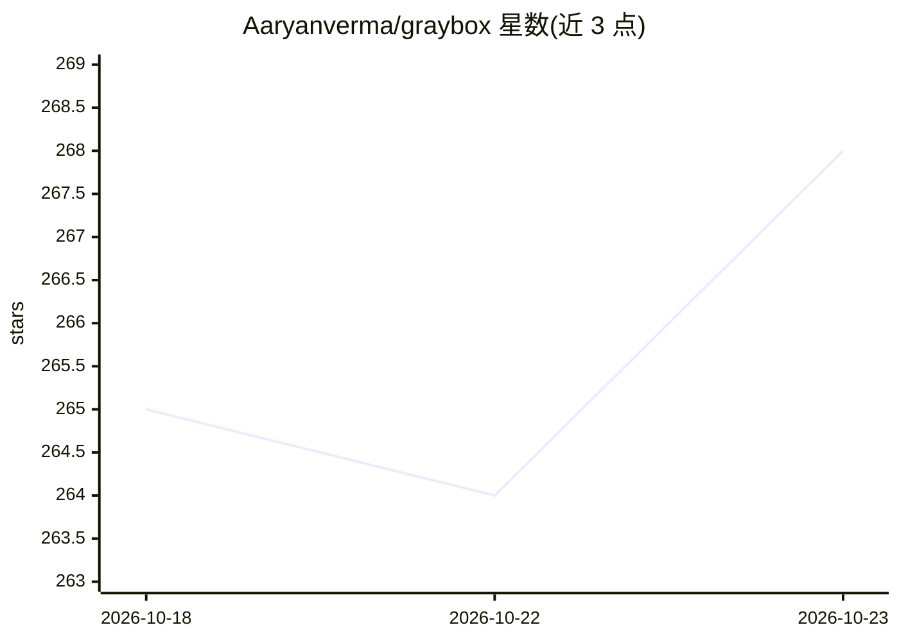

# Aaryanverma/graybox

⭐ 268 · Python · MIT · 推送 2026-09-15 · [GitHub](https://github.com/Aaryanverma/graybox) · [官网](https://pypi.org/project/graybox/) · 个人维护

**本地优先的个人长期记忆工具：笔记自动整理成互链 wiki 并带引用问答**

面向个人用户的本地优先笔记记忆工具，以 CLI 与 Textual 交互式 TUI 交付。capture 将原文写入不可变的 inbox；organize 由 LLM 抽取人物/项目/任务/会议/决策等结构化事实，再由确定性 Python 代码生成与合并互链 Markdown wiki 页面；ask/chat 基于关键词+可选语义+图扩展检索，让 LLM 仅用检索到的上下文作答并附引用，找不到时明示。存储为纯 Markdown+YAML frontmatter，无数据库、无云依赖；LLM 经 LiteLLM 接入 OpenAI/Anthropic/Gemini/Ollama 等任意后端。支持多工作区隔离与 HTML dashboard 导出，不解析 PDF/DOCX。

## 筛选速览

| 维度 | 判定 | 备注 |
|---|---|---|
| AI 角色 | `ai-native` | 本体是模型或模型工具 |
| 许可风险 | `permissive` | MIT |
| 部署形态 | `library` | 以包/库形式分发 |
| 模型依赖 | local-ok | 支持本地模型 |
| 硬件要求 | — | 无带数字的原话,不猜 |
| 安装摩擦 | `low` | 无编译、无系统依赖或容器化 |
| 成熟度 | — | 结构信号不足 |

## 能力要点

- capture→organize→ask 流程：LLM 抽取事实，确定性代码写 wiki，inbox 原文不可变
- 检索带内联引用，仅用检索上下文作答，无证据时拒绝猜测
- 纯 Markdown+YAML 存储，无向量数据库（嵌入为可选升级）
- 经 LiteLLM 可切换 OpenAI/Anthropic/Gemini/Ollama 等任意模型后端

## 适用场景

- 把会议、待办、灵感随手记下，之后用带引用的问答找回
- 个人/工作分工作区管理各自的知识
- 用 TUI 或 CLI 脚本化地维护个人长期记忆库

## 场景标签

`知识库管理` `文档问答` · 领域:知识与检索

## 证据(README 行号)

> L34: 3. **Answers questions** about anything you've captured, citing exactly which note or page it got the answer from —
> L49: |🔌 **Pluggable LLM**|Powered by LiteLLM under the hood, so you can point it at OpenAI, Anthropic, Gemini, Mistral, 
> L66: - **Retrieval** — when you `ask` or `chat`, it searches wiki pages first (keyword + optional semantic), expands fro

## 星数曲线

2026-10-18 265 → 2026-10-23 268（+3）

---
*卡片 v1 · prompt 1.4 · 生成 2026-10-22 · 置信度 high · 依据 README sha `14c318c0cee1` · [字段定义](../../DATASET.md)*
