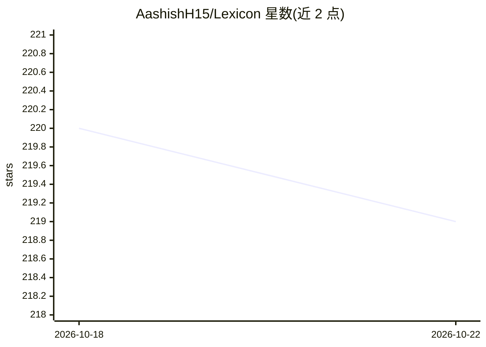

# AashishH15/Lexicon

⭐ 220 · JavaScript · MIT · 推送 2026-10-20 · [GitHub](https://github.com/AashishH15/Lexicon) · [官网](https://lexicon-writer.pages.dev/) · 个人维护

**离线优先的本地写作助手：校对、改写与语气调整全在本机**

面向写作者的本地优先富文本编辑器（React/TipTap + FastAPI + Tauri）：提供基于 LanguageTool 的本地语法拼写校对、语气检测与可读性评分；下载内置模型（约 0.8/1.4 GB，llama.cpp 后端）后可本地改写、精简、九种语气调整、摘要与表格转换，也可改用本机已运行的 Ollama 服务。支持 .txt/.md/.html 导入与 HTML/文本/Markdown/PDF 导出；不联网、无账户，模型下载仅首次连接 Hugging Face。提供 Windows/macOS/Linux 安装包；源码运行需 Python、Node.js 与 Java。构建未签名，Windows/macOS 可能触发系统拦截提示。

## 筛选速览

| 维度 | 判定 | 备注 |
|---|---|---|
| AI 角色 | `ai-enhanced` | 去掉 AI 部分产品仍成立 |
| 许可风险 | `permissive` | MIT |
| 部署形态 | `desktop` | 安装包/桌面程序 |
| 模型依赖 | local-ok | 支持本地模型 |
| 硬件要求 | — | 无带数字的原话,不猜 |
| 安装摩擦 | `low` | 无编译、无系统依赖或容器化 |
| 成熟度 | — | 结构信号不足 |

## 能力要点

- LanguageTool 本地语法校对，无需 AI 模型即可使用
- 内置 llama.cpp 后端运行本地模型，提供改写/语气/摘要等 AI 工具
- 可改用本机已有 Ollama 服务作为 AI 后端
- 跨平台安装包（Windows 三架构/macOS 双架构/Linux deb 与 AppImage），数据不出本机

## 适用场景

- 想在不联网、不上传文稿的前提下完成写作与校对
- 对草稿做改写、语气调整和摘要等本地 AI 处理
- 导出干净排版的 PDF/Markdown/HTML 稿件

## 场景标签

`AI 写作` · 领域:内容生成

## 证据(README 行号)

> L27: Lexicon is a distraction-free rich-text editor with inline proofreading,
> L97: The editor and proofreading tools work without downloading an AI model. The AI

## 星数曲线

2026-10-18 220 → 2026-10-22 219（-1）

---
*卡片 v1 · prompt 1.4 · 生成 2026-10-22 · 置信度 high · 依据 README sha `cb4d408f30ce` · [字段定义](../../DATASET.md)*
