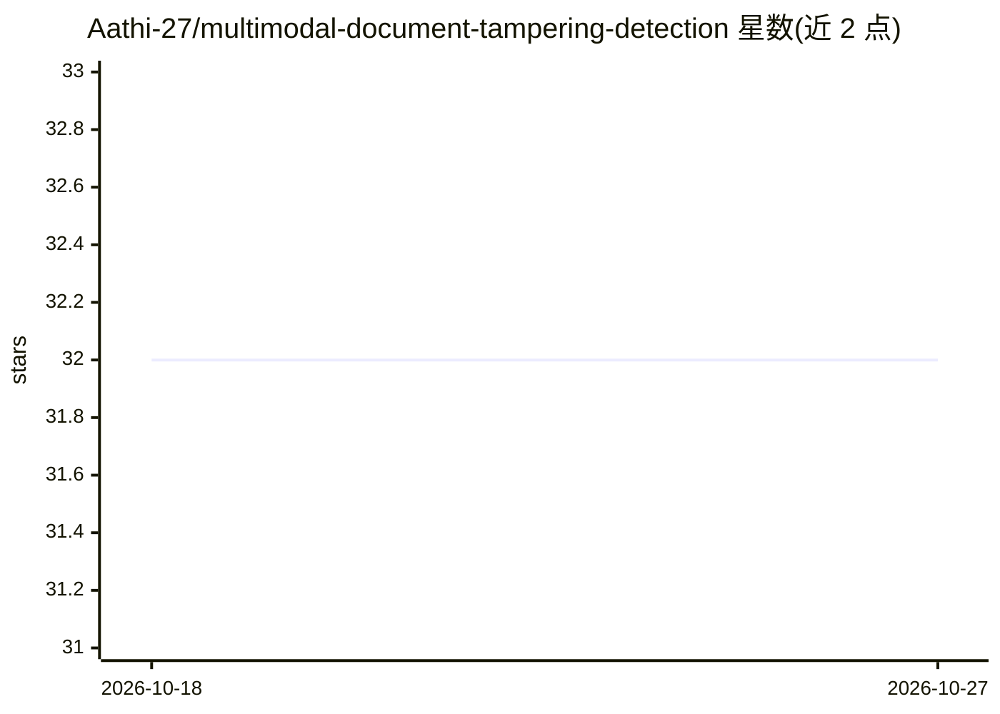

# Aathi-27/multimodal-document-tampering-detection

⭐ 32 · Python · MIT-0 · 推送 2026-09-10 · [GitHub](https://github.com/Aathi-27/multimodal-document-tampering-detection) · 个人维护

**银行文件篡改检测系统：CV+OCR 六信号融合与风险评分**

面向银行文件欺诈检测的多模态管线：对文档图像或 PDF 并行运行 ELA、Grad-CAM、MC Dropout、OCR 空间匹配、patch 定位等 6-7 种信号，加权融合后输出分层风险评分与热图。提供 Streamlit 本地应用、FastAPI REST 后端（API key 认证、OpenAPI 文档）和 React/Next.js 仪表盘，另含报告生成、文档类型分类、多语言 OCR（17+ 语言）、A/B 测试、漂移监控、告警（Email/Slack/SMS）与 TFLite/ONNX 模型优化脚本。MIT-0 许可。

## 筛选速览

| 维度 | 判定 | 备注 |
|---|---|---|
| AI 角色 | `ai-native` | 本体是模型或模型工具 |
| 许可风险 | `permissive` | MIT-0 |
| 部署形态 | `library` | 以包/库形式分发 |
| 模型依赖 | — | README 未给出锁定关系 |
| 硬件要求 | — | 无带数字的原话,不猜 |
| 安装摩擦 | `low` | 无编译、无系统依赖或容器化 |
| 成熟度 | — | 结构信号不足 |

## 能力要点

- 6 信号 CV+OCR 并行融合管线（ELA、Grad-CAM、MC Dropout、OCR 空间 IoU 等）
- FastAPI REST 后端 + React/Next.js 仪表盘 + Streamlit 应用三种交付形态
- PDF 支持、17+ 语言 OCR、文档类型自动分类（paystub/银行流水/证件/护照）
- A/B 测试、预测漂移监控、对抗鲁棒性测试与 TFLite/ONNX 优化脚本

## 适用场景

- 我需要检测银行流水、工资单等文件是否被篡改
- 构建文档欺诈检测的 REST API 服务与可视化仪表盘
- 对检测模型做漂移监控、告警与量化部署优化

## 场景标签

`图像视频处理` `OCR` `目标检测` · 领域:感知与多模态

## 证据(README 行号)

> L3: Real-time bank document fraud detection using an **optimized 6-signal CV+OCR fusion pipeline** with parallel executi
> L36:       ├─► ela.py               → ELA tampering score + heatmap (in-memory)

## 星数曲线

2026-10-18 32 → 2026-10-27 32（+0）

---
*卡片 v1 · prompt 1.4 · 生成 2026-10-26 · 置信度 mid · 依据 README sha `1de76cc371e8` · [字段定义](../../DATASET.md)*
