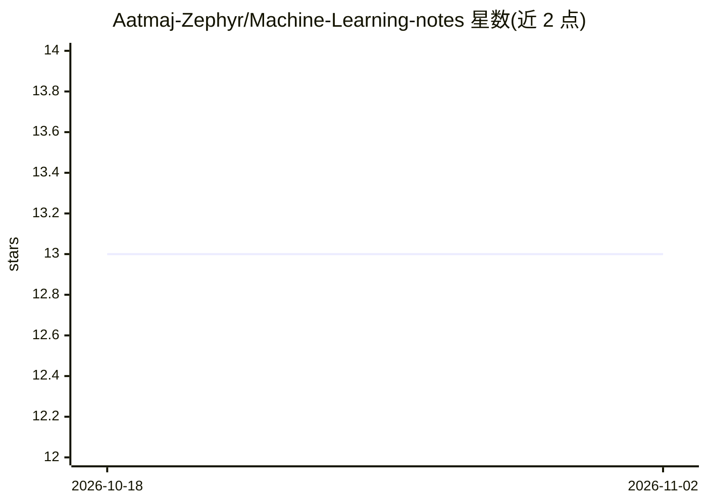

# Aatmaj-Zephyr/Machine-Learning-notes

⭐ 13 · Python · 推送 2026-01-04 · [GitHub](https://github.com/Aatmaj-Zephyr/Machine-Learning-notes) · 个人维护

**手写机器学习学习笔记及配套课程资源清单**

个人维护的机器学习手写笔记仓库，README 汇总了大量外部学习资源：3Blue1Brown 的微积分/线性代数/神经网络视频、IIT Madras BS 学位频道、StatQuest、NPTEL 课程（IIT KGP/IIT Roorkee/IIT Ropar）以及 IIT Bombay 的概率论 PPT、强化学习讲义和机器学习基础课程等。README 建议以笔记覆盖的教学大纲为主线，配合这些资源深入学习。仓库本身为文档内容，未提供安装或运行方式。

## 筛选速览

| 维度 | 判定 | 备注 |
|---|---|---|
| AI 角色 | `ai-knowledge` | 知识聚合/清单类 |
| 许可风险 | `none` | — |
| 部署形态 | `None` |  |
| 模型依赖 | — | README 未给出锁定关系 |
| 硬件要求 | — | 无带数字的原话,不猜 |
| 安装摩擦 | `low` | 无编译、无系统依赖或容器化 |
| 成熟度 | — | 结构信号不足 |

## 能力要点

- 手写机器学习笔记为主体内容
- 汇总 3B1B、NPTEL、IIT 系列等数学与 ML 课程资源
- 建议以教学大纲为主线串联资源学习

## 适用场景

- 初学者按清单寻找机器学习与数学基础课程
- 配合笔记大纲系统复习 ML 主题
- 查找印度 IIT/NPTEL 系公开课入口

## 场景标签

`教程课程` `精选清单` · 领域:学习与行业

## 证据(README 行号)

> L1: # Machine Learning notes (Handwritten)
> L9: 1) Playlists for ML

## 星数曲线

2026-10-18 13 → 2026-11-02 13（+0）

---
*卡片 v1 · prompt 1.4 · 生成 2026-10-31 · 置信度 high · 依据 README sha `0cb9f4e6aabc` · [字段定义](../../DATASET.md)*
