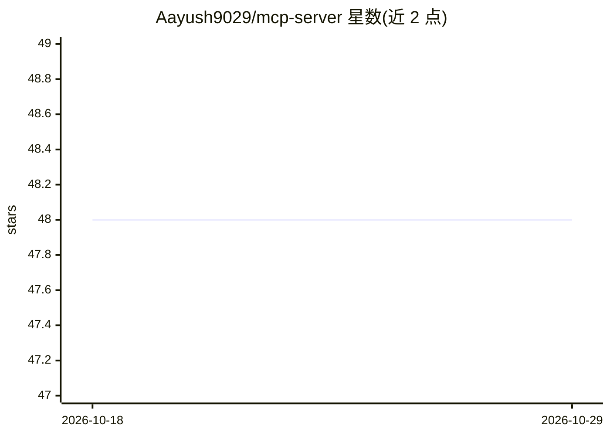

# Aayush9029/mcp-server

⭐ 48 · Python · MIT · 推送 2026-10-14 · [GitHub](https://github.com/Aayush9029/mcp-server) · [官网](https://relaydeck.onrender.com) · 个人维护

**把 AI agent 任务同步到 iPhone/手表的 MCP 服务器**

基于 FastAPI 的任务管理 MCP 服务器，将 Claude Code、Cursor、Codex 等 AI 工具连接到 iPhone、iPad、Apple Watch：agent 通过 11 个工具创建/更新/删除任务、发送推送通知、提问并等待用户回答，设备端通过配套 App Relaydeck（App Store 提供）实时显示变更与锁屏 Live Activity，用户也可从手机下发任务给 agent。安装走 curl 脚本选择 agent 并粘贴 API key，或手动配置 MCP 客户端；依赖 Relaydeck 云端 API，各 key 数据隔离、仅存哈希。

## 筛选速览

| 维度 | 判定 | 备注 |
|---|---|---|
| AI 角色 | `ai-ecosystem` | LLM/agent 周边工具 |
| 许可风险 | `permissive` | MIT |
| 部署形态 | `None` |  |
| 模型依赖 | — | README 未给出锁定关系 |
| 硬件要求 | — | 无带数字的原话,不猜 |
| 安装摩擦 | `low` | 无编译、无系统依赖或容器化 |
| 成熟度 | — | 结构信号不足 |

## 能力要点

- 11 个 MCP 工具覆盖任务增删改查、通知与问答
- 推送通知、锁屏 Live Activity 实时同步到 iOS 设备
- 用户可从手机回答 agent 提问或下发任务
- 每个 API key 数据完全隔离，仅存密钥哈希

## 适用场景

- 让 Claude Code 在编码会话中创建并跟踪任务
- agent 完成工作或部署前通过手机收到通知确认
- 多个 AI 工具与自动化脚本共享任务跟踪

## 场景标签

 · 领域:开发工具/AI agent 集成

## 证据(README 行号)

> L15: ## Task Management MCP Server
> L19: This MCP server connects Claude Code, Cursor, Codex, and other AI tools to your iPhone, iPad, and Apple Watch. Your

## 星数曲线

2026-10-18 48 → 2026-10-29 48（+0）

---
*卡片 v1 · prompt 1.4 · 生成 2026-10-25 · 置信度 high · 依据 README sha `22f4932a2e9e` · [字段定义](../../DATASET.md)*
