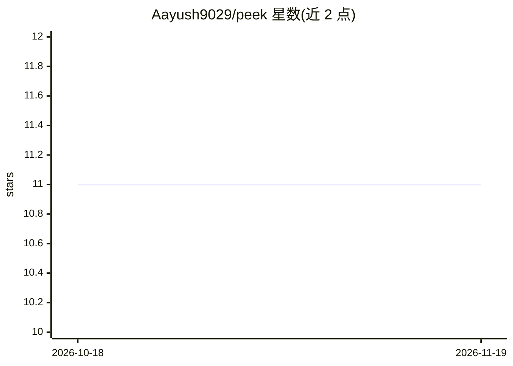

# Aayush9029/peek

⭐ 11 · Shell · MIT · 推送 2026-11-11 · [GitHub](https://github.com/Aayush9029/peek) · 个人维护

**终端里用视觉 LLM 描述并命名图片视频的 CLI**

peek 是一个命令行工具，通过视觉 LLM 读取图片与视频并生成描述，输出可用于管道的制表符分隔结果（name\tdescription），可用于对图片/视频文件做描述与重命名。通过 Homebrew 安装，需配置 OPENROUTER_API_KEY，视频处理依赖 ffmpeg。macOS 平台，README 以示例命令展示图片、视频及指定帧数的用法。

## 筛选速览

| 维度 | 判定 | 备注 |
|---|---|---|
| AI 角色 | `ai-native` | 本体是模型或模型工具 |
| 许可风险 | `permissive` | MIT |
| 部署形态 | `None` |  |
| 模型依赖 | locked-api |  |
| 硬件要求 | — | 无带数字的原话,不猜 |
| 安装摩擦 | `medium` | 含编译或系统依赖之一 |
| 成熟度 | — | 结构信号不足 |

## 能力要点

- 终端内对图片和视频生成视觉描述
- 管道输出为制表符分隔的 name\tdescription
- 支持指定帧数的视频分析（--frames）
- Homebrew 一条命令安装

## 适用场景

- 批量生成图片文件的文字描述用于重命名
- 在 shell 脚本/管道中处理图像描述输出
- 从视频中抽取帧做内容描述

## 场景标签

`多模态` · 领域:感知与多模态

## 证据(README 行号)

> L3:  Describe images and videos from the terminal using vision LLMs
> L23: Requires `OPENROUTER_API_KEY` (get one).

## 星数曲线

2026-10-18 11 → 2026-11-19 11（+0）

---
*卡片 v1 · prompt 1.4 · 生成 2026-11-19 · 置信度 high · 依据 README sha `06934907008c` · [字段定义](../../DATASET.md)*
