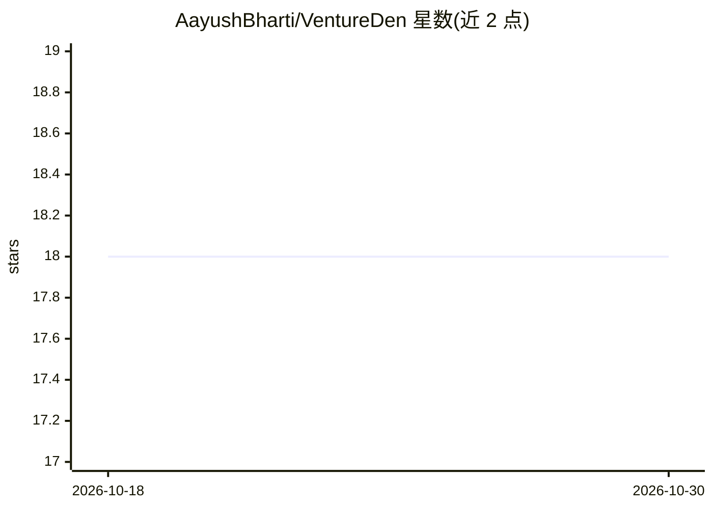

# AayushBharti/VentureDen

⭐ 18 · TypeScript · MIT · 推送 2026-07-03 · [GitHub](https://github.com/AayushBharti/VentureDen) · [官网](https://venture-den.aayushbharti.in) · 个人维护

**AI 初创路演平台：创始人提交 pitch，获 Gemini 即时评分与建议**

面向早期创始人的路演展示平台：创始人通过多步表单和富文本编辑器提交 pitch，平台调用 Google Gemini 对每份 pitch 按清晰度、市场定位、独特性三项打分（0–100）并给出加权总分与 2–3 条可执行建议；同时提供路演浏览与模糊搜索、分类筛选、投票、评论、公开创始人主页与 GitHub OAuth 登录。技术栈为 Next.js 16 + Sanity CMS + Turborepo 的 pnpm monorepo，含可视化页面构建器、博客与 PWA。本地运行需 Node.js 22+、pnpm 10+ 并配置 Sanity 与 Gemini 相关环境变量。

## 筛选速览

| 维度 | 判定 | 备注 |
|---|---|---|
| AI 角色 | `ai-native` | 本体是模型或模型工具 |
| 许可风险 | `permissive` | MIT |
| 部署形态 | `library` | 以包/库形式分发 |
| 模型依赖 | — | README 未给出锁定关系 |
| 硬件要求 | — | 无带数字的原话,不猜 |
| 安装摩擦 | `low` | 无编译、无系统依赖或容器化 |
| 成熟度 | — | 结构信号不足 |

## 能力要点

- Gemini 对 pitch 的清晰度/市场定位/独特性三项打分（0–100）与可执行建议
- 多步提交流程含 Novel/Tiptap 富文本编辑器
- 投票、评论、浏览量与公开创始人主页的社区功能
- Sanity Studio v5 可视化编辑与可组合首页区块构建器

## 适用场景

- 作为创始人提交初创点子并获得 AI 评分与改进建议
- 浏览、搜索和投票发现社区里的初创路演
- 作为搭建 Next.js + Sanity monorepo 全栈应用的参考实现

## 场景标签

 · 领域:Web 应用/创投社区

## 证据(README 行号)

> L44: **VentureDen** is an **AI-powered startup pitch platform** where early-stage founders submit pitches, receive insta
> L60: |**AI pitch analysis**|Every pitch scored by Google Gemini on **clarity, market positioning & uniqueness** (0–100) 
> L83: - Google Gemini: Generative AI for pitch analysis.

## 星数曲线

2026-10-18 18 → 2026-10-30 18（+0）

---
*卡片 v1 · prompt 1.4 · 生成 2026-10-29 · 置信度 mid · 依据 README sha `70f7e149cbeb` · [字段定义](../../DATASET.md)*
