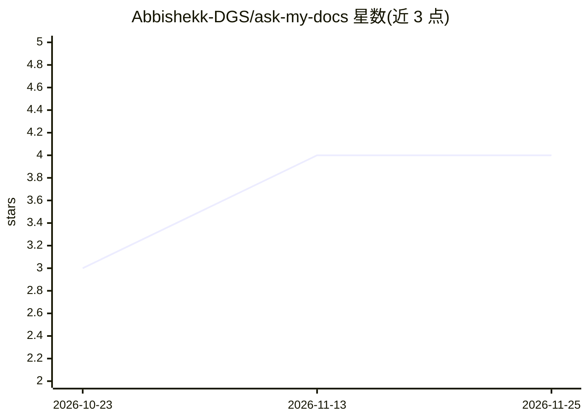

# Abbishekk-DGS/ask-my-docs

⭐ 4 · Python · MIT · 推送 2026-11-02 · [GitHub](https://github.com/Abbishekk-DGS/ask-my-docs) · 个人维护

**本地 RAG 问答工具：对 PDF/笔记提问并给出带编号引用的答案**

一个完全本地运行的检索增强生成（RAG）引擎：读取 PDF、Markdown 和文本文件，按结构切块（段落→句子→单词，40 词重叠），将稠密向量检索与 BM25 关键词检索通过 RRF 融合，提示词强制每条论断附 [n] 引用并标注文件与页码，找不到时输出明确回退。支持终端命令（ingest/ask/stats）与 Streamlit 浏览器聊天界面，重索引基于内容哈希、幂等。依赖 Ollama 本地运行模型，无 API key、无云端调用。

## 筛选速览

| 维度 | 判定 | 备注 |
|---|---|---|
| AI 角色 | `ai-native` | 本体是模型或模型工具 |
| 许可风险 | `permissive` | MIT |
| 部署形态 | `None` |  |
| 模型依赖 | local-ok | 支持本地模型 |
| 硬件要求 | — | 无带数字的原话,不猜 |
| 安装摩擦 | `low` | 无编译、无系统依赖或容器化 |
| 成熟度 | — | 结构信号不足 |

## 能力要点

- 混合检索：稠密向量 + BM25，RRF 融合排序
- 答案强制 [n] 编号引用，定位到文件与页码
- 终端 CLI 与 Streamlit 聊天界面两种使用方式
- 内容哈希幂等索引，默认模型 qwen2.5:3b + nomic-embed-text

## 适用场景

- 离线向自己的 PDF 和笔记提问并获得带引用的回答
- 检索含发票号、人名等精确词条的文档
- 在 8 GB 内存的笔记本上本地搭建文档问答

## 场景标签

`RAG` `文档问答` · 领域:知识与检索

## 证据(README 行号)

> L3: **Chat with your PDFs and notes, 100% locally.** AskMyDocs is a retrieval-augmented generation (RAG) engine that com
> L17: You can use it from the terminal or from a chat app in the browser.
> L31: Install it with `uv sync --extra ui`, then start it with `uv run streamlit run src/ask_my_docs/app.py`.

## 星数曲线

2026-10-23 3 → 2026-11-25 4（+1）

---
*卡片 v1 · prompt 1.4 · 生成 2026-11-21 · 置信度 high · 依据 README sha `9b8e6f0f9e5f` · [字段定义](../../DATASET.md)*
