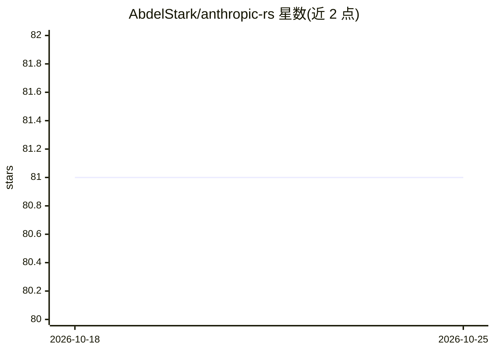

# AbdelStark/anthropic-rs

⭐ 81 · Rust · MIT · 推送 2026-04-08 · [GitHub](https://github.com/AbdelStark/anthropic-rs) · [官网](https://docs.rs/anthropic) · 个人维护

**面向 Rust 开发者的 Anthropic Messages API 异步 SDK**

Typed async Rust 客户端库，封装 Anthropic Messages API：结构化请求构建、SSE 流式响应（StreamAccumulator 折叠为完整响应）、run_tool_loop 工具调用循环、prompt caching 与 extended thinking、图片/文档块、count_tokens、模型列表与 Message Batches 批处理。基于 Tokio 与 Reqwest，通过环境变量配置 API key 与超时，支持 rustls/native-tls 及可选 tracing 特性。给在 Rust 项目中接入 Claude 的开发者使用，以 crates.io 包与源码方式提供。

## 筛选速览

| 维度 | 判定 | 备注 |
|---|---|---|
| AI 角色 | `ai-ecosystem` | LLM/agent 周边工具 |
| 许可风险 | `permissive` | MIT |
| 部署形态 | `library` | 以包/库形式分发 |
| 模型依赖 | — | README 未给出锁定关系 |
| 硬件要求 | — | 无带数字的原话,不猜 |
| 安装摩擦 | `low` | 无编译、无系统依赖或容器化 |
| 成熟度 | — | 结构信号不足 |

## 能力要点

- SSE 流式响应折叠为完整 MessagesResponse（含 thinking/tool-use delta）
- run_tool_loop 单辅助函数驱动完整工具调用-执行-回复循环
- 覆盖 prompt caching、extended thinking、图片/文档内容块
- Message Batches 批处理全生命周期管理与按请求重试策略

## 适用场景

- 在 Rust 应用中调用 Claude Messages API 生成回复
- 构建带工具调用的 agent 循环
- 大批量请求走 Message Batches 异步处理

## 场景标签

 · 领域:LLM 基础设施/SDK

## 证据(README 行号)

> L3: Typed async Rust client for Anthropic's Messages API with structured requests, SSE streaming, and tool-use payloads.
> L167: |`run_tool_loop(&client, request, executor, config)`|`Result<MessagesResponse, AnthropicError>`|Agentic call/execu

## 星数曲线

2026-10-18 81 → 2026-10-25 81（+0）

---
*卡片 v1 · prompt 1.4 · 生成 2026-10-24 · 置信度 high · 依据 README sha `50b2c454a18e` · [字段定义](../../DATASET.md)*
