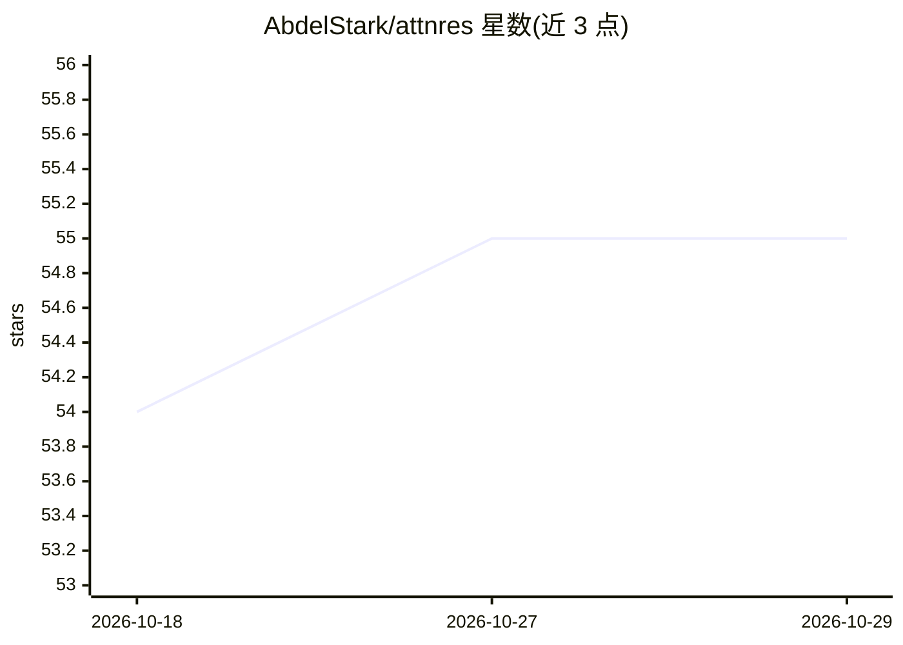

# AbdelStark/attnres

⭐ 55 · Rust · MIT · 推送 2026-03-23 · [GitHub](https://github.com/AbdelStark/attnres) · [官网](https://abdelstark.github.io/attnres/) · 个人维护

**Rust 实现的 Attention Residuals Transformer 组件与参考实现**

基于 burn 深度学习框架的 Rust 库，实现 Kimi 论文中的 Attention Residuals：用对深度维的 softmax 学习式注意力替代固定残差相加。提供可复用核心组件、端到端参考 Transformer、两阶段推理原语、序列化助手、基准与终端/浏览器两个演示。面向验证论文或改造模型的研究者与 burn 生态的 Rust 工程师。项目自述处于 alpha 阶段：CI 仅验证 NdArray 后端，不支持 PyTorch/safetensors 检查点导入导出，无 1.0 API 稳定性承诺。

## 筛选速览

| 维度 | 判定 | 备注 |
|---|---|---|
| AI 角色 | `ai-native` | 本体是模型或模型工具 |
| 许可风险 | `permissive` | MIT |
| 部署形态 | `library` | 以包/库形式分发 |
| 模型依赖 | — | README 未给出锁定关系 |
| 硬件要求 | — | 无带数字的原话,不猜 |
| 安装摩擦 | `low` | 无编译、无系统依赖或容器化 |
| 成熟度 | `idea` | |

## 能力要点

- 核心深度注意力残差算子与双 AttnRes 子层的参考 Transformer 实现
- 论文的两阶段推理原语与 burn record 格式存取助手
- WASM 浏览器演示与终端 TUI 演示
- 确定性 CPU 测试（单元/集成/性质/差分）覆盖

## 适用场景

- 在 Rust/burn 环境中复现或验证 Attention Residuals 论文
- 将该残差算子作为组件集成到自有 Transformer 实验
- 通过浏览器或终端演示检视算法行为

## 场景标签

`科研工具` · 领域:学习与行业

## 证据(README 行号)

> L3: `attnres` is a Rust library that implements Attention Residuals for
> L13: Attention Residuals replace fixed residual additions with learned softmax
> L17: - A reference Transformer implementation built on burn.

## 星数曲线

2026-10-18 54 → 2026-10-29 55（+1）

---
*卡片 v1 · prompt 1.4 · 生成 2026-10-24 · 置信度 mid · 依据 README sha `a989b1a0695c` · [字段定义](../../DATASET.md)*
