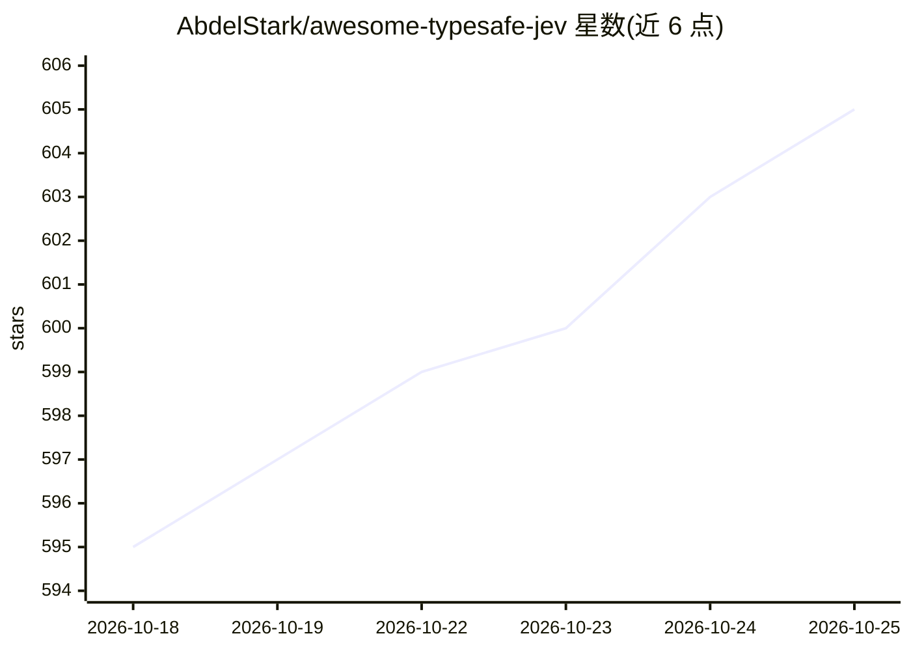

# AbdelStark/awesome-typesafe-jev

⭐ 605 · HTML · MIT · 推送 2026-10-19 · [GitHub](https://github.com/AbdelStark/awesome-typesafe-jev) · [官网](https://abdelstark.github.io/awesome-typesafe-jev/) · 个人维护

**TypeSafe Jev 模型的社区策展指南：接入路径与独立评测**

围绕 TypeSafe 的 Jev（System One）模型的社区领域指南，非官方附属项目：解释 Choice/Score/Noul 三种类型化判定原语，给出从 API key 到首个调用的 JavaScript/Python SDK 示例，列举 TypeSafe 直连、Cloudflare Workers AI、Netlify/Vercel AI Gateway、OpenRouter 等接入路径，收录社区项目（pg-jev、Kev、Jevals.com）并汇总五项独立失败模式研究（KoBBQ 弃权、级联成本、路由阈值认证等）。提供 JSON 目录下载与在线站点。

## 筛选速览

| 维度 | 判定 | 备注 |
|---|---|---|
| AI 角色 | `ai-knowledge` | 知识聚合/清单类 |
| 许可风险 | `permissive` | MIT |
| 部署形态 | `library` | 以包/库形式分发 |
| 模型依赖 | — | README 未给出锁定关系 |
| 硬件要求 | — | 无带数字的原话,不猜 |
| 安装摩擦 | `medium` | 含编译或系统依赖之一 |
| 成熟度 | — | 结构信号不足 |

## 能力要点

- Choice/Score/Noul 三种类型化判定原语的文档与示例
- 五条接入路径对比（TypeSafe 直连/Cloudflare/Netlify/Vercel/OpenRouter）
- 五项独立评测研究的失败模式与上线前测试建议
- 可下载的 JSON 目录与浏览器内问题设计器

## 适用场景

- 了解 Jev 类型化判定模型如何接入工作流
- 为工单分类、路由阈值等场景选择判定原语
- 查阅独立评测以设计上线前的测试方案

## 场景标签

`精选清单` `模型评测` · 领域:评测与运维

## 证据(README 行号)

> L12:  A community field guide to TypeSafe's Jev: see one documented call, try live projects, copy a starter, and inspect
> L54: **Independent community project.** This repository is not affiliated with or endorsed by TypeSafe AI. Community ent

## 星数曲线

2026-10-18 595 → 2026-10-25 605（+10）

---
*卡片 v1 · prompt 1.4 · 生成 2026-10-21 · 置信度 mid · 依据 README sha `473c3f082512` · [字段定义](../../DATASET.md)*
