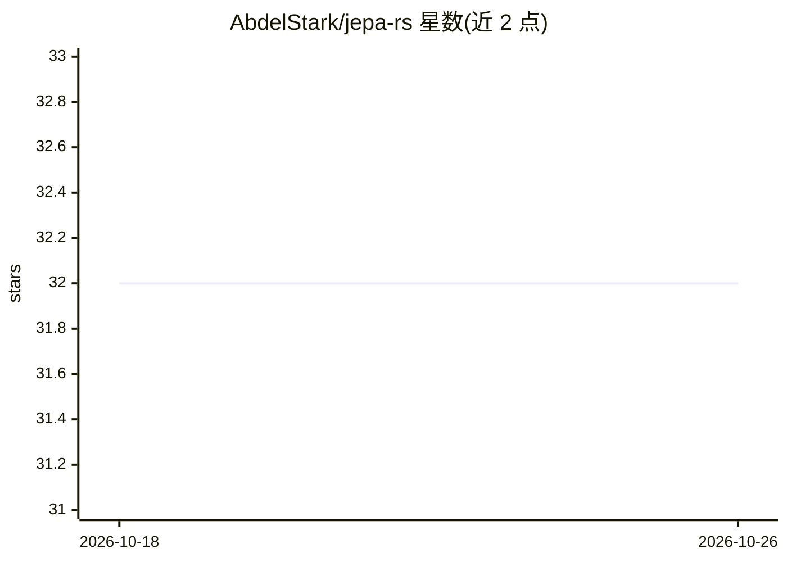

# AbdelStark/jepa-rs

⭐ 32 · Rust · MIT · 推送 2026-03-16 · [GitHub](https://github.com/AbdelStark/jepa-rs) · 个人维护

**Rust 实现的 JEPA 自监督学习与世界模型框架**

基于 burn 深度学习框架的 JEPA（联合嵌入预测架构）Rust 实现，覆盖 I-JEPA（图像）、V-JEPA（视频）、C-JEPA（因果对象中心）与分层世界模型，在表征空间而非像素空间做预测。提供后端无关的 API（CPU/WGPU/WASM）、safetensors 检查点加载、ONNX 元数据检查、Facebook Research 预训练模型注册表，以及含 6 个命令的 CLI 与交互式 TUI。项目自述为 alpha 阶段，适合研究与本地演示，视频 parity 与 ONNX 图执行尚未完成。

## 筛选速览

| 维度 | 判定 | 备注 |
|---|---|---|
| AI 角色 | `ai-native` | 本体是模型或模型工具 |
| 许可风险 | `permissive` | MIT |
| 部署形态 | `library` | 以包/库形式分发 |
| 模型依赖 | — | README 未给出锁定关系 |
| 硬件要求 | — | 无带数字的原话,不猜 |
| 安装摩擦 | `medium` | 含编译或系统依赖之一 |
| 成熟度 | `idea` | |

## 能力要点

- 实现 I-JEPA / V-JEPA / C-JEPA 及分层世界模型架构
- 支持加载 Facebook Research 官方预训练模型（ViT-S 到 ViT-G）
- 后端无关：CPU (NdArray)、GPU (WGPU)、WASM 均可运行
- 提供 CLI（6 命令）、TUI 仪表盘与浏览器 demo crate
- 500+ 测试与 3 个图像 fixture 的差分 parity 测试

## 适用场景

- 在 Rust 环境中做 JEPA 自监督表征学习研究与实验
- 加载并检查官方 I-JEPA / V-JEPA 预训练权重进行编码推理
- 构建基于表征空间预测的世界模型与规划实验

## 场景标签

`模型训练` · 领域:训练与推理

## 证据(README 行号)

> L10: Alpha Rust implementation of **JEPA** (Joint Embedding Predictive Architecture) — the self-supervised learning fram
> L12: **jepa-rs** provides modular, backend-agnostic building blocks for I-JEPA (images), V-JEPA (video), C-JEPA (causal 

## 星数曲线

2026-10-18 32 → 2026-10-26 32（+0）

---
*卡片 v1 · prompt 1.4 · 生成 2026-10-26 · 置信度 high · 依据 README sha `1c730e2304fc` · [字段定义](../../DATASET.md)*
