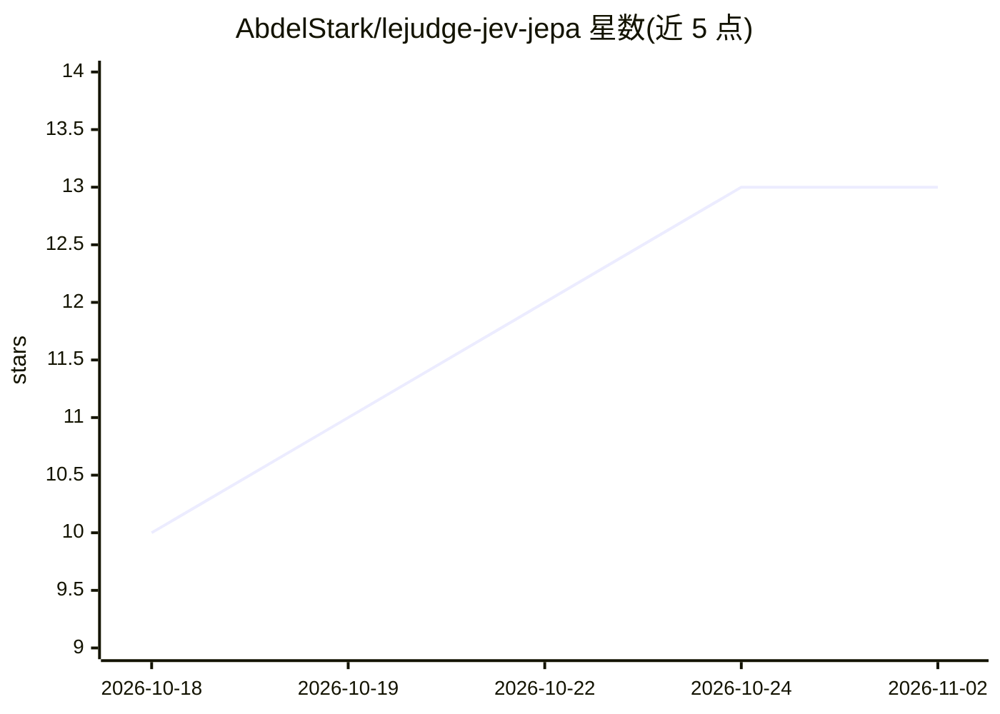

# AbdelStark/lejudge-jev-jepa

⭐ 13 · Python · MIT · 推送 2026-09-24 · [GitHub](https://github.com/AbdelStark/lejudge-jev-jepa) · 个人维护

**用自然语言约束 JEPA 世界模型规划的判定模块**

面向 JEPA 类潜空间世界模型（LeWM）规划的研究代码：在 CEM 候选动作序列的代价函数中加入第二项，约束以英文书写，由 TypeSafe System One 决策模型 Jev 对线性探针产生的离散词（网格、接触、角度等）逐一作是/否判定并返回概率，全程无 LLM 参与且外部响应全部缓存。提供三种约束族（never/always/soft）的聚合方式与步事实记忆化，配套预注册的三项研究、oracle 对照与可复现论文构建流程。实验在 PushT 任务上完成，结果显示剩余误差主要来自世界模型漂移而非判定器。

## 筛选速览

| 维度 | 判定 | 备注 |
|---|---|---|
| AI 角色 | `ai-native` | 本体是模型或模型工具 |
| 许可风险 | `permissive` | MIT |
| 部署形态 | `library` | 以包/库形式分发 |
| 模型依赖 | — | README 未给出锁定关系 |
| 硬件要求 | — | 无带数字的原话,不猜 |
| 安装摩擦 | `low` | 无编译、无系统依赖或容器化 |
| 成熟度 | — | 结构信号不足 |

## 能力要点

- 自然语言约束经线性探针转词后由决策模型 Jev 判定，环路内无 LLM
- 代价项按 never/always/soft 三族聚合，步事实记忆化跨迭代/回合复用
- 内置 oracle 对照与三项预注册研究，论文数值由 parquet 结果程序化填充
- 外部响应全缓存，论文可离线重建

## 适用场景

- 为 JEPA 世界模型规划器添加人可写的软/硬约束
- 研究判定器、代价机制与世界模型各自的误差贡献
- 复现 PushT 上的约束规划实验与论文数值

## 场景标签

 · 领域:机器学习研究/世界模型规划

## 证据(README 行号)

> L5: **Natural-language constraints for JEPA world-model planning, judged by a decision model instead of an LLM.**
> L20: LeWorldModel (LeWM) plans by minimising one number: the latent distance between an imagined final state and a goal 
> L24: 3. **Judge.** Jev, TypeSafe's System One decision model, answers one typed yes/no question per (constraint, step), 

## 星数曲线

2026-10-18 10 → 2026-11-02 13（+3）

---
*卡片 v1 · prompt 1.4 · 生成 2026-10-31 · 置信度 high · 依据 README sha `54035f648cf7` · [字段定义](../../DATASET.md)*
