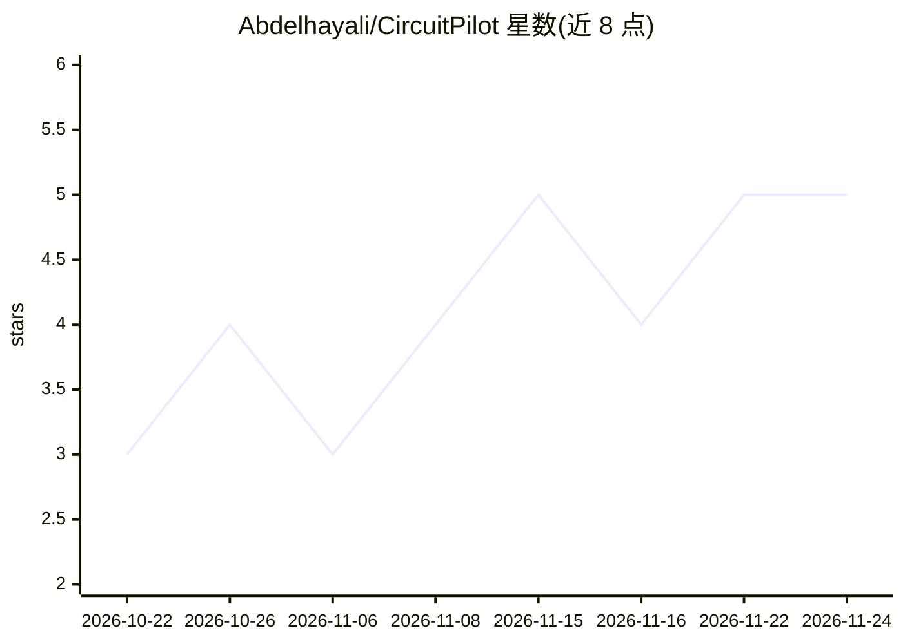

# Abdelhayali/CircuitPilot

⭐ 5 · JavaScript · NOASSERTION · 推送 2026-11-19 · [GitHub](https://github.com/Abdelhayali/CircuitPilot) · [官网](https://pcbgo.site/) · 个人维护

**对话式 PCB 设计助手：从描述生成原理图、布局与 Gerber**

基于浏览器的 EDA 工具，用户用自然语言描述电路后由 LLM 调用工具完成选料（JLCPCB/LCSC 数据库）、绘制原理图、ERC、放置与自动布线 2 层板、导出 Gerber/BOM，并生成 3D 打印外壳（STL/OpenSCAD）。提供 Windows 安装包、源码运行（Python 3）与在线版三种方式；支持 Claude Desktop/Claude Code 经 MCP 控制设计工具，或内置 copilot 连接多种模型端点。

## 筛选速览

| 维度 | 判定 | 备注 |
|---|---|---|
| AI 角色 | `ai-native` | 本体是模型或模型工具 |
| 许可风险 | `none` | NOASSERTION |
| 部署形态 | `desktop` | 安装包/桌面程序 |
| 模型依赖 | local-ok | 支持本地模型 |
| 硬件要求 | — | 无带数字的原话,不猜 |
| 安装摩擦 | `medium` | 含编译或系统依赖之一 |
| 成熟度 | — | 结构信号不足 |

## 能力要点

- 从一句话提示到自动布线、DRC 检查的完整 PCB 流程
- 搜索 JLCPCB/EasyEDA/开源元件库，每个元件带真实封装与引脚
- 三种 copilot 模式：Agent 编辑、Ask 只读问答、Plan 生成 BOM+网表计划后执行
- 本地元件档案离线可用（Basic 件约 1.3MB，全量约 45 万件）

## 适用场景

- 快速从想法得到可送 JLCPCB 打样的 2 层板
- 为 ESP32 等模块生成传感器板设计与数据手册
- 在无 JLCPCB 在线搜索时离线检索元件库

## 场景标签

`AI 助手` · 领域:对话与助手

## 证据(README 行号)

> L3: An AI copilot for electronics design: describe a circuit in plain language and it picks **real parts from the JLCPCB
> L108: - **Model picker** — Claude (Fable 5.1, Opus 5.5, Sonnet 5.5, Haiku 4.5) or any OpenAI-compatible endpoint (OpenAI

## 星数曲线

2026-10-22 3 → 2026-11-24 5（+2）

---
*卡片 v1 · prompt 1.4 · 生成 2026-11-22 · 置信度 high · 依据 README sha `f9d0c44349b9` · [字段定义](../../DATASET.md)*
